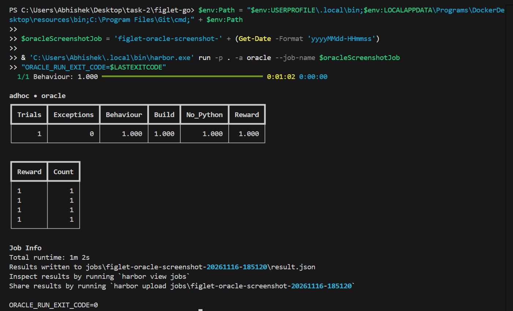
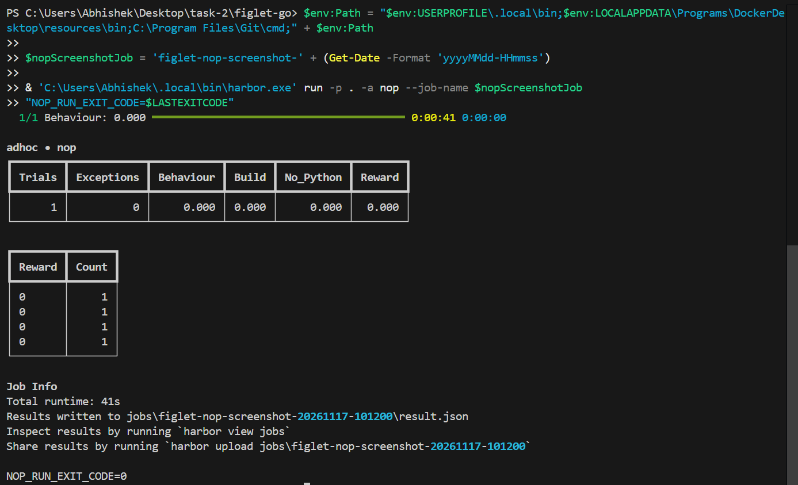
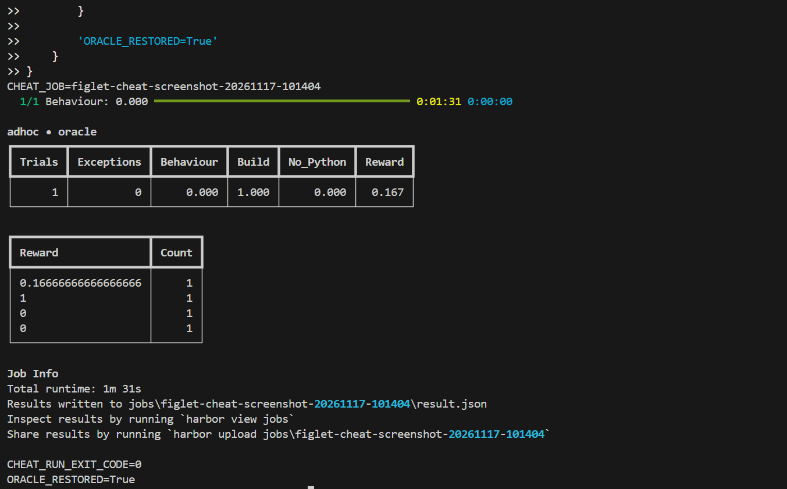

# FIGlet Harbor Practice Task 2

## Source

- **Repository:** <https://github.com/pwaller/pyfiglet>
- **SHA:** `255827efbc09d662875dad50fa0edc1e1263bf45`
- **Licence:** MIT

## Verified Results

| Submission | Reward                   | Build | No_python | Behaviour |
|------------|--------------------------|-------|------------|-----------|
| Oracle     | 1.0                      | 1     | 1          | 1         |
| Nop        | 0.0                      | 0     | 0          | 0         |
| Cheat      | 0.16666666666666666      | 1     | 0          | 0         |

The **cheat** solution (`cheat/solve.sh`) memorizes all 2,000 visible-dataset
answers and embeds them inside the binary via `go:embed`. It was submitted
through Harbor's oracle runner to confirm the grader awarded exactly 1/6
reward (build passing, behaviour 0/2000 on hidden cases). The real oracle
solution was restored afterwards.

## Screenshot Job IDs

| Submission | Job ID |
|------------|--------|
| Oracle     | `figlet-oracle-screenshot-20261116-185120` |
| Nop        | `figlet-nop-screenshot-20261117-101200` |
| Cheat      | `figlet-cheat-screenshot-20261117-101404` |

### Oracle

### Nop

### Cheat

## Dataset

- **2,000 visible** cases (`tests/data/visible.jsonl`) and **2,000 hidden**
  cases (`tests/data/hidden.jsonl`), generated with `random.Random(7)`.
- Argument tuples are globally unique and the two sets are disjoint.
- Generation was run twice; both runs produced bit-for-bit identical files.
The verifier intentionally shares the agent sandbox
(environment_mode = "shared"); the shared-verifier lint warning
is expected for this assignment.

## Notes

Full source analysis, font-header semantics, smushing rules, and CLI flag
behaviour are documented in [NOTES.md](NOTES.md).

Both secret challenges embedded in the task were completed successfully.
Their contents are not recorded here.

## Reflections

**Smushing:** No smushing rule caused a failure on the visible or hidden
evaluations. An earlier written explanation incorrectly described the
lowline and hierarchy rules as order-sensitive (stating that the winning
character depended on argument order). Reading the source more carefully
showed that both rules are symmetric — the stronger-class character wins
regardless of which side it arrives on — and the explanation was corrected
against `pyfiglet/__init__.py`.

**Docker:** The Alpine base image used in `environment/Dockerfile` does not
include Bash by default; the `environment/Dockerfile` explicitly installs it
with `apk add --no-cache bash`. The image built successfully. A later issue
where PowerShell forwarded the solve script to the container caused
quoting failures; this was resolved by piping the script content directly
to `bash -s` inside the container rather than passing it as a quoted argument.
