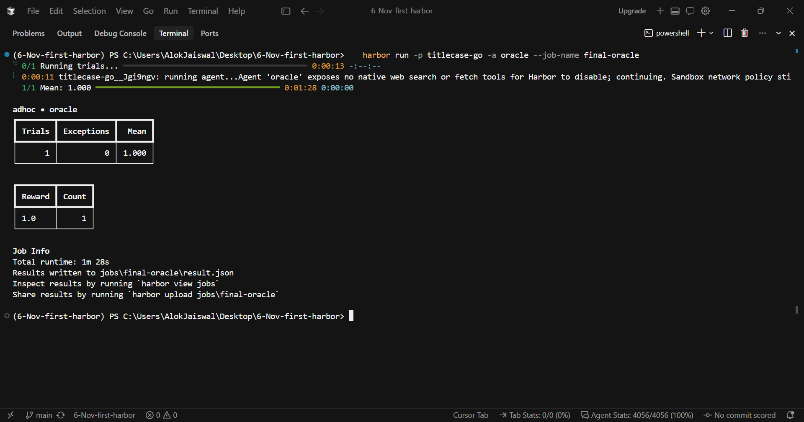
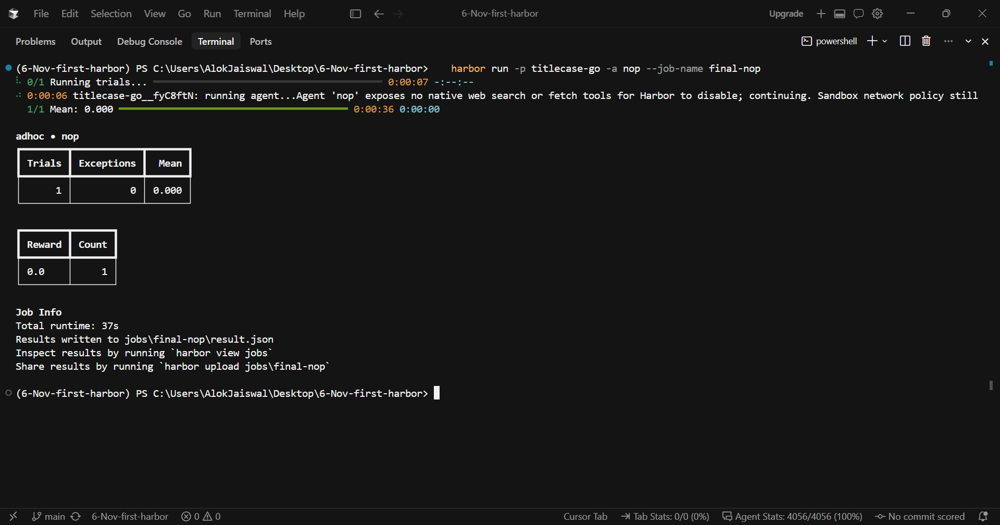
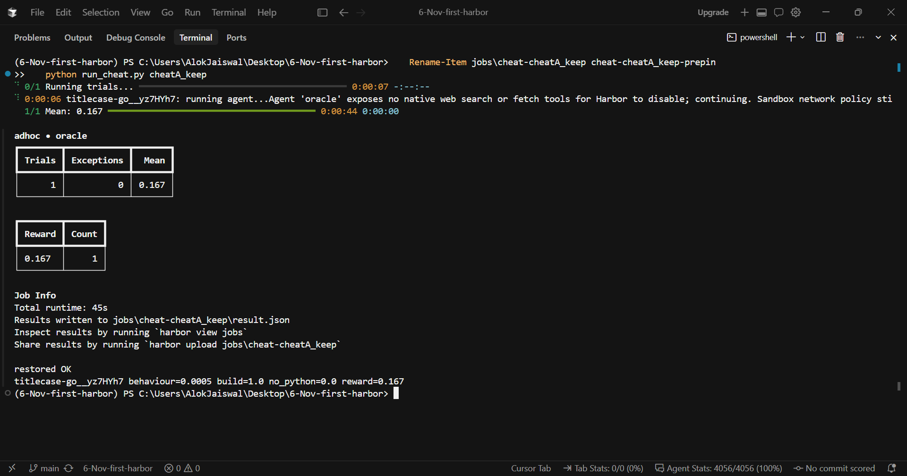

# titlecase-go: build log for a Harbor task

Task: replace the Python `titlecase()` function of [python-titlecase](https://github.com/ppannuto/python-titlecase) with a Go program that gives byte-identical output. This file records every step, the commands I ran, and why I decided what I decided. Windows 11, PowerShell, Docker Desktop, Cursor agent for code, Harbor 0.25.0.

Labels: **verified** = I ran it and saw the result. **Inferred** = reasoning, not tested.

## Result

| Run | Reward | Expected |
|---|---|---|
| Oracle (`final-oracle`, `copy-oracle`) | 1.0 | 1.0 |
| Nop (`final-nop`) | 0.0 | 0.0 |
| Cheat A, prints embedded dev answers, keeps `.py` | 0.167 | below 0.2 |
| Cheat A, deletes `.py` | 0.334 | not required |
| Cheat B, echoes input, keeps `.py` | 0.197 | not required |
| Cheat B, deletes `.py` | 0.364 | not required |
| Exploits C, D, E (hidden-answer read, Python via `os/exec`, Python via `os.StartProcess`) | 0.333 (behaviour 0.0) | behaviour 0 |

Screenshots: `screenshots/`. Reward = (build + no_python + 4 x behaviour) / 6.

## Layout

```
README.md  NOTES.md  HANDIN.md
titlecase-go/       the Harbor task (instruction, task.toml, Dockerfile, solution, tests)
oracle_dev/         Go source that solution/solve.sh is generated from
cheat/              cheat and exploit scripts used to test the grader
scripts/            data checks, oracle build, validation (all paths anchored to the repo root)
screenshots/        oracle, nop, cheat
```

## 0. Setup

```powershell
docker run --rm hello-world
powershell -ExecutionPolicy ByPass -c "irm https://astral.sh/uv/install.ps1 | iex"
uv tool install harbor --python 3.12
harbor --version                       # 0.25.0
git config --global core.autocrlf input
[Environment]::SetEnvironmentVariable("PYTHONUTF8","1","User")
[Environment]::SetEnvironmentVariable("PYTHONDONTWRITEBYTECODE","1","User")
```

- **`--python 3.12`:** plain `uv tool install harbor` picked Python 3.15, `pyyaml` had no prebuilt wheel, and the build failed asking for Visual C++. Pinning 3.12 avoided installing a compiler. (verified)
- **Native Windows, not WSL2:** the tooling worked natively, so I stayed. WSL2 was the fallback.
- **`autocrlf input`:** bash scripts with CRLF line endings break inside Linux containers.
- **`PYTHONUTF8=1`:** `harbor run` crashed with a cp1252 `UnicodeDecodeError` reading `instruction.md` (curly quotes). (verified)
- **`PYTHONDONTWRITEBYTECODE=1`:** importing the original code from `environment/repo` created `__pycache__` there, and that folder is copied into the image. I deleted it and set this variable. (verified)

## 1. Source repo

```powershell
git clone https://github.com/ppannuto/python-titlecase
cd python-titlecase; git log -1 --format='%H %cI'   # 42f43e2de55bf003b286c6f8e8d8b2d26676a167  2024-04-05
cd ..; uv venv --python 3.12; .venv\Scripts\activate
uv pip install .\python-titlecase
python -c "from titlecase import titlecase; print(titlecase('the lord of the rings'))"
```

- **Virtual environment outside the repo:** the repo gets copied into the image, and a `.venv` inside it would add thousands of `.py` files.
- **Licence:** MIT (`LICENSE.txt`), accepted by the guide.
- **Agent wrote `NOTES.md` rules, I verified them:** 18 examples re-run against the real code, all matched. The agent's list missed leading and trailing whitespace: `titlecase(' a thing ')` gives `' a Thing '`. (verified)
- **Finding:** the original source has no regex look-ahead, look-behind or back-references (searched `__init__.py`), so the brief's "Go can't copy the regexes" difficulty does not exist at this commit. (verified)

## 2. Task skeleton and Dockerfile

```powershell
harbor task init titlecase-go           # organisation prompt: alokinethara
docker build -f environment/Dockerfile -t titlecase-go environment      # from titlecase-go/
docker run --rm titlecase-go ls -a /workspace/repo
docker run --rm titlecase-go sh -c "which python3 python pip"
```

- **Repo copied into `environment/repo` first:** Docker can only `COPY` from inside the build folder. Excluded `.git`, `__pycache__`, build folders.
- **`harbor task init`, not `harbor init`:** both exist in 0.25.0; the guide uses the first.
- **Found:** `python3` exists in `golang:1.23`. A Go binary could call it, so "no Python" had to be enforced later (section 9). (verified)

## 3. instruction.md

Decisions, each of which is a sentence I can test:

- **Input space:** printable ASCII, tab, and the characters ‘ ’ “ ” – —. A smaller set than "any UTF-8" so Python/Go Unicode-table differences cannot make the task unfair. (inferred)
- **Rules stated:** Go standard library only, no `os/exec`, read only stdin, no `.py` left, no downloads, 60 s for 2000 lines.
- **Left out on purpose:** the leading-space quirk and all test details. Spelling them out would turn a hidden requirement into a hint; the byte-for-byte rule already implies them.
- **Checked against the real code:** empty line gives empty line, whitespace-only line comes back unchanged. (verified)

## 4. task.toml

```powershell
harbor task schema | Out-File $HOME\schema.json -Encoding utf8
harbor lint titlecase-go --select ALL
```

- `[agent] timeout_sec = 3600`, up from 600: ten minutes is likely too short for a port, and cutting time is not fair hardening. The number is a guess. (inferred)
- `[agent] network_mode = "allowlist"`, `allowed_hosts = []`: stops the agent downloading an existing Go port. The nop and oracle runs worked with it.
- `artifacts = [{ source = "/workspace/repo", destination = "repo" }]`: Harbor then collects the agent's repo. (verified)
- Verifier left in `separate` mode (the default) so the agent cannot touch the tests.

## 5. Test data

`tests/gen.py` (seeds 1 and 2) writes `inputs.txt`/`expected.txt` (dev) and `hidden_inputs.txt`/`hidden_expected.txt` (hidden), 2000 lines each, 11 categories (small words, all caps, apostrophe names, dotted tokens, URLs, slashes and hyphens, internal capitals, digits and punctuation, whitespace, honorifics, long lines). The hidden set has more multi-category lines (60% vs 40%).

```powershell
python scripts\data\verify_data.py
python scripts\data\spotcheck.py
```

- **Answers come only from the original code**, imported from `environment/repo` (the script asserts the import path).
- **Dev set for debugging, hidden set for grading,** so I never tune the port to the graded data.
- **Empty line in both sets:** the instruction states a rule about empty lines, and the hidden set had none, so I allowed that one shared line. (verified)
- **Deterministic:** two runs, identical hashes. Hashes are in `NOTES.md`. Files are written with `encoding="utf-8", newline="\n"` because Windows Python otherwise changes line endings.

## 6. Mutation check: do the tests exercise every rule?

```powershell
python scripts\validation\mutation_check.py
```

23 deliberate single-rule breakages of a temp copy of the original, counting changed lines per set. 20 mutants change at least 18 hidden lines. Three change none: `line-breaks` (input has no newlines), `callback` (the program has no callback), `all-caps-initials` (redundant with the inline-period rule on this input set). Documented, not fixed: they are unreachable under the instruction's own contract.

## 7. Verifier and reward

```powershell
harbor run -p titlecase-go -a nop --job-name probe2     # throwaway test.sh that lists the verifier filesystem
```

- **Probe first, no guessing:** the verifier sees the agent's repo at `/workspace/repo`, has no Go, and defaults to grading `/app`. (verified)
- **`tests/Dockerfile`:** Python 3.12 image plus Go copied from `golang:1.23` plus `harbor-rewardkit==0.2.2`. Installed at image build, not in `test.sh`, because `harbor lint` flags runtime installs.
- **Three checks:** `build` (1), `no_python` (1, passes only if the build passes too, so deleting files earns nothing), `behaviour` (4, share of exact byte-matching hidden lines). `reward.toml` is a weighted mean.
- **Guide weights kept** (1/1/4). Weakness noted in section 9.
- **Nop:** reward 0.0. (verified)

## 8. Oracle

```powershell
python scripts\oracle\dev_compare.py           # builds oracle_dev in Docker, diffs against expected.txt
python scripts\oracle\build_solve.py           # generates solution/solve.sh, sha256 81e08307...2fc0
harbor run -p titlecase-go -a oracle --job-name oracle1
harbor run -p titlecase-go -a oracle -k 3 -n 1 --job-name oracle2
```

- **Developed in `oracle_dev/`, embedded later:** debugging Go inside a shell heredoc is painful, and the generator keeps one source of truth.
- **Stub first:** an echo program must score exactly 103 of 2000 dev lines equal, which validated the comparison harness before any porting. (verified)
- **First draft from the agent in one pass:** 2000/2000 dev lines, 1.0 on the hidden set. Standard library only, only `os.Stdin`, `os.Stdout`, `os.Exit` used.
- **Result:** oracle 1.0; 3 of 3 repeated trials 1.0.

## 9. Cheats, found weaknesses, hardening

```powershell
python scripts\validation\predict_cheats.py     # predicted rewards before running anything
python scripts\validation\build_cheats.py
python scripts\validation\run_cheat.py cheatA_keep   # swaps solve.sh, always restores it, checks the sha256
```

- **Predicted, then measured:** all four cheat variants matched the prediction. Structure points (`build`, `no_python`) give 0.33 to any program that compiles with no `.py`: a design weakness, written up, weights kept.
- **Exploits:** (C) a Go binary that reads `/tests/data/hidden_expected.txt`; (D) one that runs the original Python through `os/exec`. Both scored **1.0** against the first grader. (verified)
- **Fix in `tests/checks/_rules.py` and `behaviour.py`:** reject forbidden imports (`os/exec`, `syscall`, `plugin`, `unsafe`, `net`, cgo, non-standard packages) and `go.mod` `require`/`replace`/`use`; run the compiled binary under `chroot` as uid 65534 in an empty folder; 240 s timeouts on builds.
- **Exploit E** (Python via `os.StartProcess`, which passes the import rules) tests the jail alone. After the fix C, D and E all score behaviour 0.0; oracle still 1.0, nop still 0.0. Which layer stopped which exploit is inferred; I did not disable layers one at a time.
- **Bug I caused and fixed:** `run_cheat.py` read old results after Harbor refused a reused job name. It now refuses to reuse a job folder and checks Harbor's exit code.

## 10. Pin the images

Digests are in both Dockerfiles (`golang:1.23@sha256:60deed95...`, `python:3.12-slim@sha256:4840d514...`). Same images I had been using; pinning only locks them. `harbor lint titlecase-go --select ALL` now reports only `root-agent`.

## 11. Final runs

```powershell
harbor run -p titlecase-go -a oracle --job-name final-oracle
harbor run -p titlecase-go -a nop --job-name final-nop
python scripts\validation\run_cheat.py cheatA_keep
```

Run last, after the task was frozen, so the screenshots describe the finished task. Results in the table at the top.







## 12. Publish

```powershell
git clone https://github.com/japjeet-ethara/Harbor_Training.git
robocopy 6-Nov-first-harbor Harbor_Training\AlokKumarJaiswal /E /XD .git .venv .venv_regex jobs python-titlecase __pycache__ solution_backup /XF *.pyc
```

- **Copy, not push my own repo:** my local repo has unrelated history.
- **Scripts moved into `scripts/`, then fixed** to find files from their own location. Reproduced: `dev_compare` 2000 equal, `build_solve` sha256 `81e08307...2fc0`, `run_cheat cheatB_keep` 0.1973, mutation check unchanged, oracle 1.0 from the copy.
- **Staged-file checks:** count, nothing outside `AlokKumarJaiswal/`, data hashes unchanged.
- Repo is public. `tests/data/hidden_*` and the full solution are therefore visible. Accepted for a practice task.

## Not proven

- **Difficulty.** No model other than the oracle's author has attempted this. One agent draft scored 100% with the source open, which suggests the task is easy (inferred). A fresh-agent run (new chat, only `instruction.md`) was not done.
- **Real-agent conditions:** whether the 3600 s timeout and the empty network allowlist suit a real model run was never tested.
- **Known gaps:** agent runs as root (`root-agent` lint); the verifier image contains Python (the jail has none); `harbor-rewardkit` dependencies unpinned; jail and import rules were validated only on Docker Desktop with Linux containers; a chroot escape is out of scope.
- **What I would change:** weights 1/1/12 (the two deleting cheats drop to about 0.14 and 0.18) or gate structure points on behaviour; make the callback and multi-line cases reachable through the CLI contract; run the fresh-agent attempt.