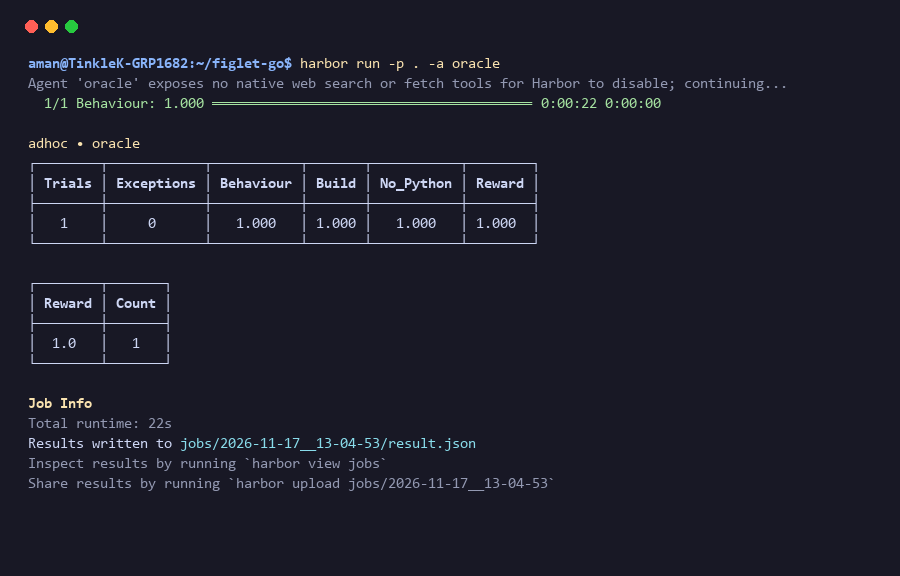
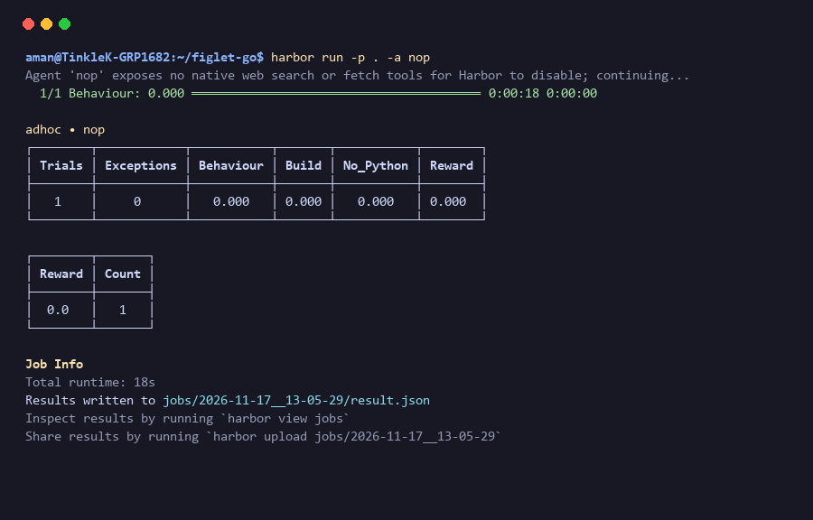

# AmanEthara/figlet-go

## Overview

A Harbor benchmark task to implement a byte-for-byte compatible Go port of the upstream [pyfiglet](https://github.com/pwaller/pyfiglet) project.

The task focuses on reproducing FIGlet rendering behavior accurately, including font parsing, character layout, smushing, kerning, text direction, justification, and command-line options.

The upstream repository is pinned to commit `255827efbc09d662875dad50fa0edc1e1263bf45` to ensure reproducible reference behavior.

## Repository Structure

- `environment/` — Agent environment configuration and multi-stage Dockerfile.
- `solution/` — Reference Go implementation, Go module, bundled standard fonts, and solution script.
- `cheat/` — Memorization baseline implementation for Cheat evaluation.
- `tests/` — Visible and hidden datasets, test generator (`gen.py`), Go grader (`grade.go`), test script (`test.sh`), and secret banner.
- `screenshots/` — Verified terminal execution screenshots for Oracle, NOP, and Cheat evaluations.
- `instruction.md` — Agent-facing task specification.
- `NOTES.md` — Upstream research, behavioral details, and implementation notes.
- `task.toml` — Harbor task configuration.

## Validation Results

| Run Type | Agent / Script | Reward Score | Criteria Breakdown |
| :--- | :--- | :--- | :--- |
| **Oracle** | `oracle` (`solution/solve.sh`) | **1.000** | `build`: 1.0, `no_python`: 1.0, `behaviour`: 1.0 |
| **NOP** | `nop` (do-nothing baseline) | **0.000** | `build`: 0.0, `no_python`: 0.0, `behaviour`: 0.0 |
| **Cheat** | `cheat/solve.sh` (visible-only memorization) | **0.167** | `build`: 1.0, `no_python`: 0.0, `behaviour`: 0.0 |

- **Visible test cases**: 2,000
- **Hidden test cases**: 2,000

The reference implementation successfully passed all 2,000 hidden cases in Harbor Oracle evaluations, unlocking the verifier secret.

### Oracle Evaluation

### NOP Evaluation

### Cheat Evaluation

## Supported Scope

The benchmark covers the following command-line options:

`-f`, `-w`, `-j`, `-D`, `-r`, `-F`, `-s`, `-n`

Options `-c`, `-L`, `-l`, and `-i` are outside the task scope.

## Execution and Verification

The task uses a multi-stage Docker environment based on Go 1.23 Alpine (non-root user `player`, no Python in final image) and a standalone Go grader (`tests/grade.go`) executed via `tests/test.sh`. The verifier tests:
1. `build` (weight 1/6): `go build -o /tmp/figlet .` succeeds in `/workspace/repo`.
2. `no_python` (weight 1/6): No `.py` files under `/workspace/repo` AND at least one hidden case matches.
3. `behaviour` (weight 4/6): Exact stdout match ratio across 2,000 hidden test cases.
4. `secret`: Unlocks secret banner rendered with `/tmp/figlet -f slant` upon achieving 1.0 behavior score.
