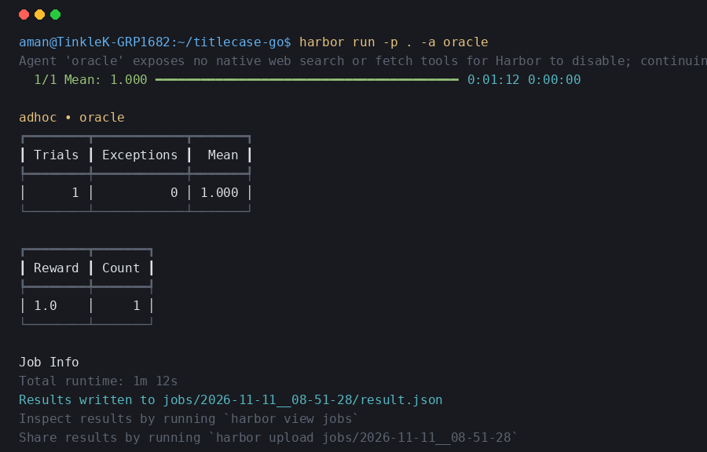
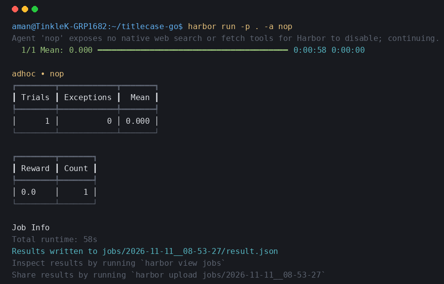

# titlecase-go: Harbor Task

A benchmark task evaluating an AI agent's ability to faithfully port the `python-titlecase` library to Go (standard library only), preserving John Gruber's titlecasing algorithm and rules byte-for-byte.

## Task Overview

- **Source Library**: `python-titlecase` (commit `42f43e2de55bf003b286c6f8e8d8b2d26676a167`, MIT License)
- **Goal**: Implement a Go CLI filter reading one title per line from stdin and printing the titlecased result to stdout.
- **Rules & Constraints**:
  - Standard Go library only (no external dependencies).
  - All `.py` files in `/workspace/repo` must be removed.
  - `go build ./...` must succeed cleanly.
  - Exact byte-for-byte match with Python `titlecase()`.
- **Verifier**: Reward Kit with weighted-mean aggregation in a separate, isolated container (`environment_mode = "separate"`).

## Scoring Criteria

$$\text{Reward} = \frac{1 \cdot \text{build} + 1 \cdot \text{no\_python} + 4 \cdot \text{behaviour}}{6}$$

1. `build` (weight 1.0): `go build ./...` succeeds in `/workspace/repo`.
2. `no_python` (weight 1.0): No `.py` files exist under `/workspace/repo` AND `go build ./...` succeeds.
3. `behaviour` (weight 4.0): Exact line match ratio against 2,000 hidden test inputs.

## Evaluation Results

| Run Type | Agent / Script | Reward Score | Criteria Breakdown |
| :--- | :--- | :--- | :--- |
| **Oracle** | `oracle` (`solution/solve.sh`) | **1.000** | `build`: 1.0, `no_python`: 1.0, `behaviour`: 1.0 |
| **Nop** | `nop` (do-nothing baseline) | **0.000** | `build`: 0.0, `no_python`: 0.0, `behaviour`: 0.0 |
| **Cheat** | `cheat/solve.sh` (hardcoded visible set) | **0.167** | `build`: 1.0, `no_python`: 0.0, `behaviour`: 0.0005 |

### Oracle

### Nop

### Cheat

## Reflection & Hardening

1. **Which rules did the agent get wrong most often?**
   - In Go, RE2 lacks lookaround and backreferences. The trickiest rules to reconstruct manually were:
     - Prefix apostrophes (`l'`, `d'`, `o'`) vs suffix contractions (`'s`, `'t`), especially when surrounded by quotes.
     - Subphrase boundary handling: capitalizing words after punctuation marks (`[:.;?!-–‒—―] `) even when they are small words.
     - Token boundary edge cases with multiple leading/trailing punctuation marks and preserving intermediate spacing verbatim.
2. **What would you add to make the task harder?**
   - Mixed Unicode quotes and dashes (e.g. `’`, `‘`, `“`, `”`, `–`, `—`, `―`) with varied whitespace encodings (NBSP, form feeds, tabs).
   - Custom callback support matching Python's `callback(word, **kwargs)` API to allow arbitrary programmatic overrides.
