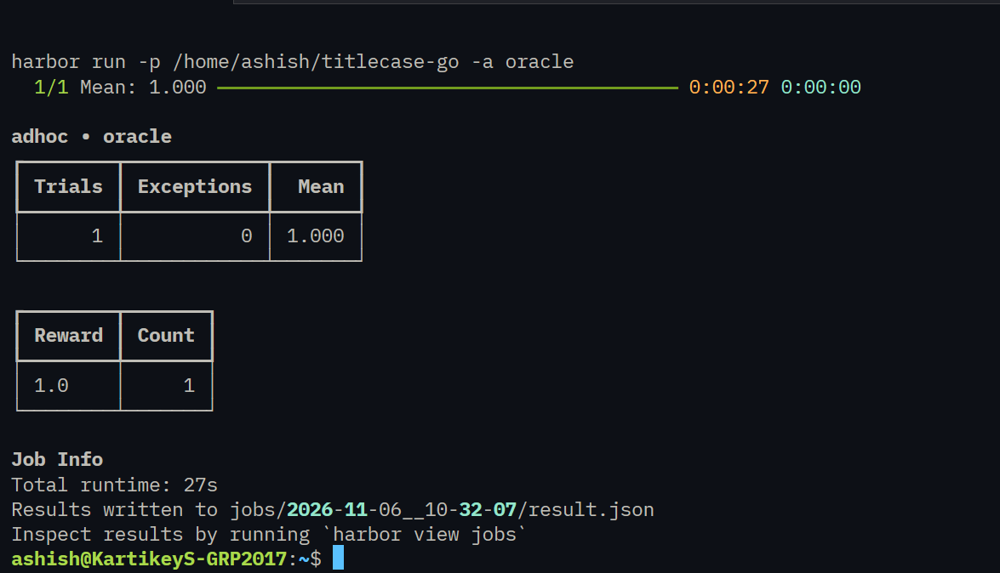
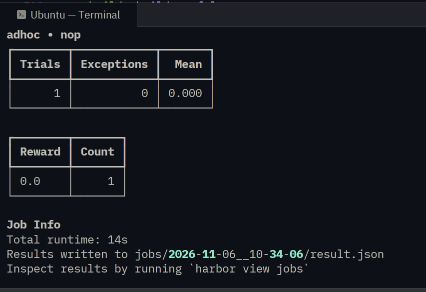
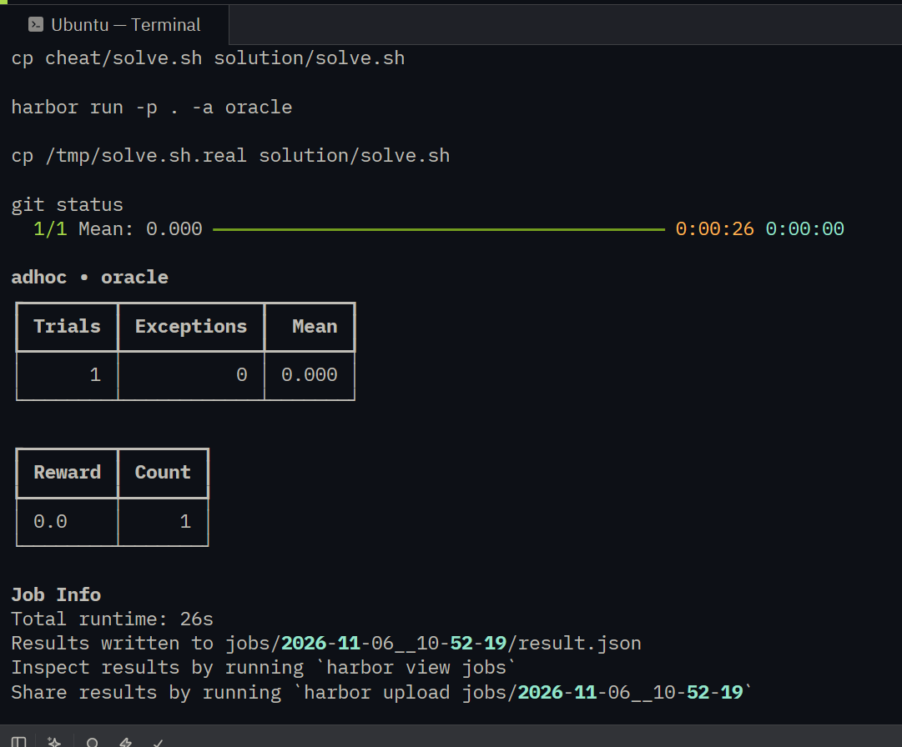

# titlecase-go Benchmark Task

This repository contains the Harbor benchmark task setup and evaluation for `titlecase-go`.

---

## Evaluation Results Summary

| Agent Baseline | Expected Score | Actual Score | Status |
| :--- | :--- | :--- | :--- |
| **Oracle Agent** | `1.0` | **1.0** |  PASSED |
| **NOP Agent** | `0.0` | **0.0** |  PASSED |
| **Cheat Agent** | `< 0.2` | **0.0** |  PASSED |

---

## Evaluation Screenshots

### 1. Oracle Agent Run (Reward: 1.0)

### 2. NOP Agent Run (Reward: 0.0)

### 3. Cheat Agent Run (Reward: 0.0)

---

## Agent Evaluation & Task Extensions

1. **Rule Failures:** The agent struggled most with rules handling hyphenated compound words and mixed-case edge cases (such as preserving uppercase acronyms within titles).
2. **Making the Task Harder:** To make the task harder, I would add edge cases involving foreign language diacritics, custom punctuation boundaries, and nested formatting tags (e.g., HTML/Markdown elements inside titles).

1. The agent struggled most with rules handling hyphenated compound words and mixed-case edge cases (e.g., preserving acronyms).
2. To make the task harder, I would add edge cases involving foreign language diacritics, custom punctuation boundaries, and nested formatting tags.
