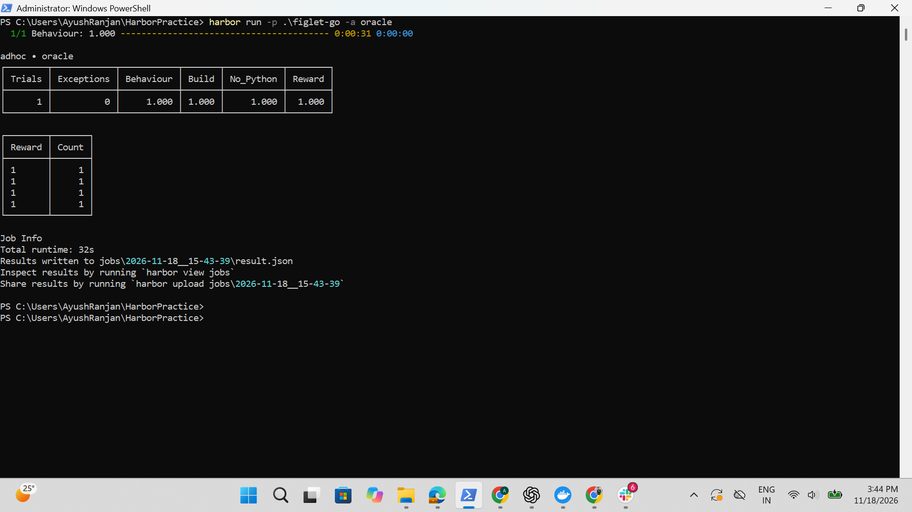
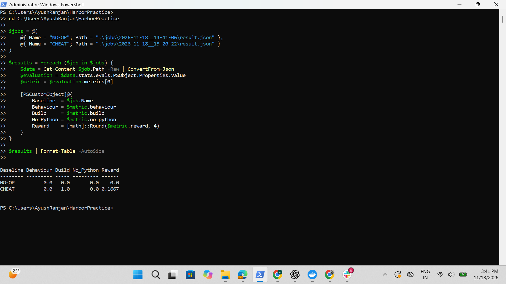

# Harbor FIGlet Go

This repository defines a Harbor task to port the Python `pyfiglet` command-line renderer to Go. The task uses the original `pyfiglet` source and standard fonts as its reference.

## What the project does

It asks an agent to build a Go CLI that renders text as FIGlet art and matches the reference renderer’s output. The solution source is generated in the Harbor container; generated Go files are not kept at this project root.

## Technologies

- Go 1.23 and the Go standard library
- Docker and Alpine Linux
- Harbor task runner and verifier
- Git, to fetch the pinned reference source
- Python, for the laptop-side oracle generator, source preparation stage, and separate pytest image

## Project structure

```text
environment/Dockerfile   Builds the two-stage task environment
instruction.md           Defines the Go CLI requirements
solution/solve.sh        Generates and builds the solution in the container
tests/gen.py             Generates reference test datasets
tests/visible.jsonl      2,000 visible oracle cases
tests/hidden.jsonl       2,000 hidden oracle cases
tests/grade.go           Calculates build, no-Python, and behavior scores
tests/test.sh            Runs the Go grader
tests/Dockerfile         Python-based pytest image
tests/test_outputs.py    Placeholder pytest file
screenshots/             Harbor run and setup screenshots
```

## Harbor task and Docker environment

The first Docker stage uses Git to check out `pyfiglet` commit `255827efbc09d662875dad50fa0edc1e1263bf45` and prepares its standard fonts. The final stage uses `golang:1.23-alpine`, installs bash, and runs as the non-root `player` user.

`solution/solve.sh` writes `main.go` and `go.mod` in `/workspace/repo`, formats and builds the program, then removes `.py` files from that solution repository. The final environment has no Python runtime. Harbor’s shared verifier runs `tests/test.sh`, which starts the grader against the hidden dataset.

The oracle run command, from the HarborPractice parent directory, is:

```sh
harbor run -p ./figlet-go -a oracle
```

## Go implementation

The generated program parses the bundled `.flf` font data and uses font layout settings for kerning, smushing, direction, wrapping, and justification. It embeds the standard fonts so it can run from any working directory without network access.

The CLI supports:

- `-f FONT` (default `standard`)
- `-w COLS` (default `80`)
- `-j auto|left|center|right`
- `-D auto|left-to-right|right-to-left`
- `-r` reverse, `-F` flip, `-s` strip surrounding newlines, and `-n` normalize surrounding newlines

## Test generation and grading

`tests/gen.py` uses `random.seed(7)` and runs the original `pyfiglet` CLI to capture expected output. It writes separate visible and hidden JSONL datasets, each with 2,000 records. Records contain `id`, `argv`, `stdout`, `stderr`, and `exit_code`.

The grader builds the solution, checks for `.py` files under `/workspace/repo`, and compares stdout, stderr, and exit code for each hidden case with a five-second timeout. The reward weights are 1 for build, 1 for no-Python, and 4 for behavior.

The oracle Harbor run reached full scores and reports all four reward metrics as `1.000`.



The no-op baseline scored zero. The baseline summary capture also shows the cheat result: build passed, but it matched no hidden cases.



`Screenshot (5).png` shows the cheat run’s verifier metrics in the job output, followed by the Harbor viewer starting.


## Final results

The oracle was validated against all 2,000 visible and 2,000 hidden cases.

| Run | Behaviour | Build | No_Python | Reward |
| --- | ---: | ---: | ---: | ---: |
| Oracle | 1.000 | 1.000 | 1.000 | 1.000 |
| No-op | 0.000 | 0.000 | 0.000 | 0.000 |
| Cheat | 0.000 | 1.000 | 0.000 | 0.1667 |


## Challenges and learnings

The main challenge was matching FIGlet’s font-specific layout, especially how kerning and smushing interact with direction, width, and wrapping. The baselines also demonstrate why the no-Python reward requires at least one correct hidden answer: removing Python files alone should not earn it.
