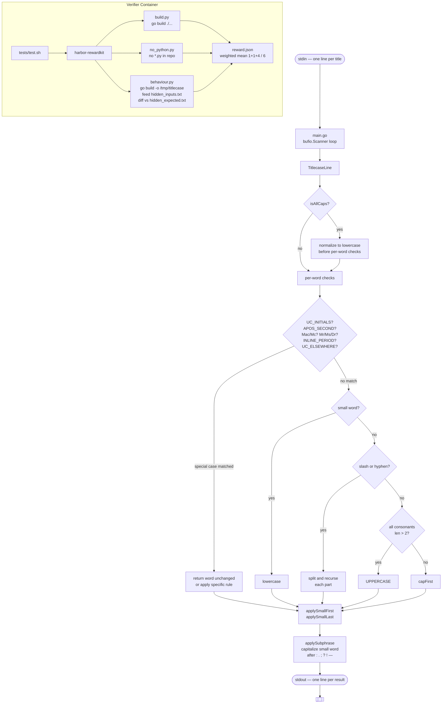

# Titlecase in Go

> A faithful Go port of the Python [`titlecase`](https://github.com/ppannuto/python-titlecase) library, built as a Harbor benchmark task.


---

## Table of Contents

- [Harbor Evaluation Results](#harbor-evaluation-results)
- [Project Overview](#project-overview)
- [Project Architecture](#project-architecture)
- [Project Structure](#project-structure)
- [Implementation Highlights](#implementation-highlights)
- [Testing and Verification](#testing-and-verification)
- [Technologies Used](#technologies-used)
- [Key Learnings](#key-learnings)
- [Author](#author)

---

## Harbor Evaluation Results

<div align="center">

### Final Score: 1.000 / 1.000

| Evaluation Criterion | Score |
|---|---:|
| Behaviour | 1.000 |
| Build | 1.000 |
| No Python Dependency | 1.000 |
| **Overall** | **1.000** |

</div>


*Screenshot of the final Harbor evaluation run, confirming a perfect score across all three weighted criteria.*

---

## Project Overview

This project implements a complete Go equivalent of the Python `titlecase` library. The Go program reads one line of text at a time from standard input and writes the correctly title-cased result to standard output — one line in, one line out.

**Why port to Go?**

The Harbor task requires the solution to:

- Compile successfully with `go build ./...`
- Produce output that matches the Python library's output byte-for-byte on 2,000 hidden test cases
- Contain no `.py` files anywhere in `/workspace/repo`

This means the Python library's title-casing rules must be reproduced entirely in Go using only the Go standard library.

**What behaviour is preserved?**

The Go implementation mirrors every rule defined in the Python source, including:

- Small-word suppression (`a`, `an`, `and`, `the`, `of`, `v.`, `vs.`, and others) in the middle of a title
- Forced capitalization of small words at the start and end of a line
- Sub-phrase capitalization after `:`, `.`, `;`, `?`, `!`, and dashes
- All-uppercase line normalization to title case
- Domain-name and initials guard (words containing `letter.letter` are left unchanged)
- Internal-capital guard (`iTunes`, `OmniFocus` are left unchanged)
- Hyphenated-word splitting with recursive title-casing of each part
- Slash-separated word splitting (but not `//`)
- All-consonants acronym uppercasing (`cnn` → `CNN`, `ftp` → `FTP`)
- `Mc`/`MC` prefix handling (`mctavish` → `McTavish`)
- `Mr`, `Mrs`, `Ms`, `Dr` preservation
- Apostrophe-second names (`o'brien` → `O'Brien`, `l'amour` → `l'Amour`)
- Unicode-safe capitalization for accented characters
- Whitespace preservation (tabs, non-breaking spaces, hair spaces)

---

## Project Architecture



**Component responsibilities:**

| Component | Role |
|---|---|
| `main.go` | Entry point. Wraps `bufio.Scanner` over stdin, calls `TitlecaseLine` for each line, writes to buffered stdout. |
| `titlecase.go` | All title-casing logic. Implements every rule from the Python library as plain Go functions using only `strings` and `unicode`. |
| `solution/solve.sh` | Oracle script. When Harbor runs the agent, this script writes `titlecase.go`, `main.go`, and `go.mod` to `/workspace/repo`, then verifies both build commands succeed. |
| `tests/criteria/build.py` | Verifier criterion (weight 1): runs `go build ./...` in `/workspace/repo`. |
| `tests/criteria/no_python.py` | Verifier criterion (weight 1): confirms no `.py` files exist under `/workspace/repo` and the build still passes. |
| `tests/criteria/behaviour.py` | Verifier criterion (weight 4): builds `/tmp/titlecase`, feeds `hidden_inputs.txt` through stdin, scores proportion of lines matching `hidden_expected.txt`. |
| `tests/criteria/reward.toml` | Aggregation config: weighted mean with weights `build=1, no_python=1, behaviour=4`. Final reward = `(build + no_python + 4×behaviour) / 6`. |

---

## Project Structure

```
titlecase-go/
├── instruction.md          # Task specification: what to build and how it is graded
├── task.toml               # Harbor task config: timeouts, verifier mode, artifact path
├── NOTES.md                # Verified behaviour rules derived from the Python source
├── reward ss.png           # Screenshot of the final Harbor evaluation result
│
├── environment/
│   ├── Dockerfile          # Agent environment: golang:1.23 base, Python source pre-copied
│   └── python-titlecase/   # Original Python titlecase library (reference implementation)
│       └── titlecase/
│           └── __init__.py # Python source that defines all title-casing rules
│
├── solution/
│   └── solve.sh            # Oracle script: generates the Go solution inside /workspace/repo
│
└── tests/
    ├── Dockerfile          # Verifier container: Python 3.12 + Go 1.23 + uv + rewardkit
    ├── test.sh             # Verifier entry point: runs harbor-rewardkit against /tests
    ├── gen.py              # Test data generator: produced inputs.txt and expected.txt
    ├── criteria/
    │   ├── build.py        # Criterion 1 — build check (weight 1)
    │   ├── no_python.py    # Criterion 2 — no-Python check (weight 1)
    │   ├── behaviour.py    # Criterion 3 — behaviour check (weight 4)
    │   └── reward.toml     # Weighted-mean aggregation config
    └── data/
        ├── inputs.txt          # 2,000 public test inputs
        ├── expected.txt        # 2,000 public expected outputs
        ├── hidden_inputs.txt   # 2,000 hidden test inputs (used by behaviour criterion)
        └── hidden_expected.txt # 2,000 hidden expected outputs (used by behaviour criterion)
```

---

## Implementation Highlights

The entire title-casing engine lives in `titlecase.go` (generated into `/workspace/repo` by `solve.sh`). It uses only Go's `strings` and `unicode` standard packages.

### Processing order

Each whitespace-separated token is processed through a strict priority chain that mirrors the Python source:

1. **UC_INITIALS guard** (all-caps lines only) — leaves `A.`, `D.C.`, `U.S.A` unchanged.
2. **APOS_SECOND** — `o'brien` → `O'Brien`, `l'amour` → `l'Amour`, `d'artagnan` → `d'Artagnan`. Vowel-initial names get an uppercase first letter; consonant-initial names get lowercase.
3. **Mac/Mc prefix** — `mctavish` → `McTavish`, `mcdonald` → `McDonald`. Recursively title-cases the suffix.
4. **Mr / Mrs / Ms / Dr** — capitalizes the first letter only; leaves the rest unchanged.
5. **Inline-period guard** — words containing `letter.letter` (domain names, dotted abbreviations) are left unchanged.
6. **UC_ELSEWHERE guard** — words whose initial letter-run already contains an uppercase letter (`iTunes`, `OmniFocus`) are left unchanged. The scan stops at the first non-letter character and does not cross hyphens.
7. **Small-word lowercasing** — `a`, `an`, `and`, `as`, `at`, `but`, `by`, `en`, `for`, `if`, `in`, `of`, `on`, `or`, `the`, `to`, `v`, `v.`, `via`, `vs`, `vs.`.
8. **Slash split** — `for/GARDEN/on` → `for/Garden/on`. Each part is recursively title-cased. Tokens containing `//` (URLs) are excluded.
9. **Hyphen split** — `end-to-end` → `End-to-End`. Each part is recursively title-cased.
10. **All-consonants acronym** — if the word contains only ASCII consonants (no vowels, no `y`) and is longer than two characters, it is uppercased: `cnn` → `CNN`, `ftp` → `FTP`. Requires the entire word to be letters — `2lmc` is left unchanged.
11. **capFirst** — capitalizes the first letter, skipping leading punctuation. Stops and returns the word unchanged if a digit appears before any letter (preserving ordinals: `5th`, `21st`).

### First and last word rules

After all tokens are processed, the first and last token of the line receive additional treatment:

- **applySmallFirst** — if the first token (after any leading punctuation) is a small word, it is capitalized.
- **applySmallLast** — the last letter-run of the final token is extracted by scanning backward past hyphens and slashes. If it is a small word and preceded by a genuine word boundary (not a digit or underscore), it is capitalized. This correctly handles `Thunder-v.-Paper-A` and `East-or-Journal-By`.

### Sub-phrase capitalization

After the full line is reassembled, `applySubphrase` scans for the pattern `[:.;?!—] ` followed by a small word and capitalizes it: `Window: on Field` → `Window: On Field`.

### Whitespace preservation

The line is split on whitespace runs, and the original separator characters (tabs, non-breaking spaces, etc.) are preserved exactly between tokens on reassembly.

---

## Testing and Verification

### How the task is evaluated

Harbor mounts the agent's `/workspace/repo` directory into a **separate verifier container** that has no access to the Python source. The verifier runs `tests/test.sh`, which invokes `harbor-rewardkit`. The reward kit discovers the three criteria in `tests/criteria/` and runs them in parallel.

| Criterion | Weight | What it checks |
|---|---:|---|
| `build` | 1 | `go build ./...` exits 0 in `/workspace/repo` |
| `no_python` | 1 | No `*.py` files anywhere under `/workspace/repo` AND build passes |
| `behaviour` | 4 | `go build -o /tmp/titlecase ./...`, then feed `hidden_inputs.txt` via stdin; score = matched lines / 2000 |

**Final reward = (build × 1 + no_python × 1 + behaviour × 4) / 6**

### Public test data

The `tests/data/` directory contains 2,000 public input/output pairs generated by `tests/gen.py` using the Python library as the oracle. These cover all major title-casing rules documented in `NOTES.md`.

### Reproducing the build

Inside the Harbor agent container (Linux, Go 1.23 available at `/usr/local/go`):

```bash
bash solution/solve.sh
```

This writes `go.mod`, `titlecase.go`, and `main.go` to `/workspace/repo`, then runs both build commands to confirm they succeed.

To test manually after the build:

```bash
echo "the quick brown fox" | /tmp/titlecase
# Output: The Quick Brown Fox

echo "FOO BAR 5TH ST" | /tmp/titlecase
# Output: Foo Bar 5th St

echo "THUNDER Summer-in-Stone" | /tmp/titlecase
# Output: THUNDER Summer-in-Stone
```

---

## Technologies Used

| Technology | Role |
|---|---|
| **Go 1.23** | Implementation language. Standard library only (`strings`, `unicode`, `bufio`, `fmt`, `os`). |
| **Harbor** | Benchmark framework. Manages the agent environment, verifier container, and reward scoring. |
| **harbor-rewardkit 0.2** | Reward kit that discovers Python criterion files, runs them, and writes `reward.json`. |
| **Python 3.12** | Used in the verifier container to run the criterion scripts. Not used in the solution itself. |
| **uv / uvx** | Fast Python package manager used in the verifier container to install and run `harbor-rewardkit`. |
| **Docker** | Provides isolated, reproducible containers for the agent environment and the verifier. |
| **python-titlecase 2.4.1** | Reference implementation. Its source defines the exact title-casing behaviour the Go port must reproduce. |

---

## Key Learnings

**Behavioral equivalence across languages**
Porting a library from Python to Go is not just a syntax translation. Python's `regex` module uses Unicode-aware character classes (`\p{Letter}`, `\p{Uppercase_Letter}`) that behave differently from Go's `unicode.IsLetter`. Every regex had to be understood semantically and re-implemented as an explicit function.

**Anchored vs. unanchored matching matters**
Python's `UC_ELSEWHERE` uses `.match()` (anchored at the start), not `.search()`. This means the pattern `[Letter]+[UpperLetter]` must be a *continuous run from the first letter*. A hyphen in the middle of a word stops the match — it cannot cross it. The Go implementation uses a `break` statement rather than a reset to match this exactly.

**Word-boundary semantics**
Python's `\b` in `SMALL_LAST` fires between any `\W` and `\w` character. This includes the boundary between a hyphen and a letter, so small words at the end of hyphenated tokens like `Thunder-v.-Paper-a` are correctly capitalized. Reproducing this required scanning backward to the last letter-run rather than the last space.

**Ordinal preservation**
Python's `CAPFIRST` regex uses `[\p{Letter}]` which does not match digits. A word like `5th` has a digit before its first letter, so the regex finds no match and the word is returned unchanged. The Go `capFirst` function mirrors this by returning immediately when a non-PUNCT, non-letter character appears before the first letter.

**Test-driven Harbor development**
The Harbor reward kit's weighted scoring (1 + 1 + 4) / 6 gives the behaviour criterion four times the weight of either structural check. This design incentivizes incremental improvement — partial behaviour scores produce partial rewards — rather than requiring a perfect score to earn any points at all.

---

## Author

**Ayush Ranjan**
