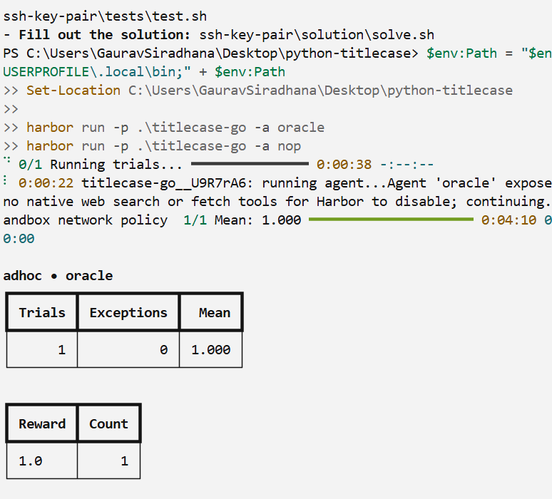
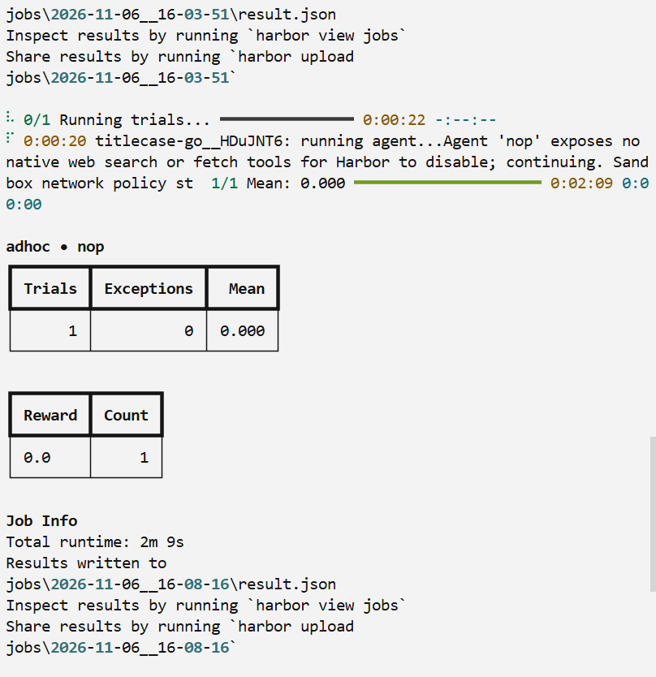

# Gaurav Siradhana — Harbor practice task: `titlecase-go`

Port [python-titlecase](https://github.com/ppannuto/python-titlecase) (MIT, SHA `42f43e2`, v2.4.1) to a Go 1.23 standard-library program. The program reads one title per line on stdin and writes the default `titlecase()` result, byte for byte.

## Results

Reward is `(build + no_python + 4 * behaviour) / 6`.

| Run | Reward | Trials | Exceptions |
|---|---:|---:|---:|
| Oracle | **1.0** | 1 | 0 |
| Nop | **0.0** | 1 | 0 |

### Oracle

```powershell
harbor run -p ./titlecase-go -a oracle
```



### Nop

```powershell
harbor run -p ./titlecase-go -a nop
```



## Task

The agent sees `instruction.md` and the Python repo at `/workspace/repo`. It must leave a `main` package that `go build ./...` builds, delete every `.py` file, and use only the Go standard library. The separate verifier scores three checks:

- **build** — `go build ./...` succeeds offline.
- **no_python** — the build passes and no `.py` file remains.
- **behaviour** — hidden titles match the original `titlecase()` line for line. The candidate runs as `nobody` and cannot read the answer files.

## Layout

```text
titlecase-go/
├── environment/
│   ├── Dockerfile
│   └── repo/            # Python project snapshot
├── solution/
│   ├── solve.sh
│   └── src/             # Go port used by the oracle
├── tests/
│   ├── data/            # visible and hidden titles
│   ├── behaviour.py
│   ├── build.py
│   ├── no_python.py
│   ├── reward.toml
│   └── test.sh
├── screenshots/
├── instruction.md
└── task.toml
```

## Author

**Gaurav Siradhana**
