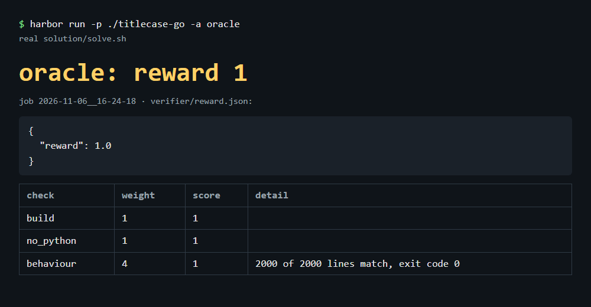
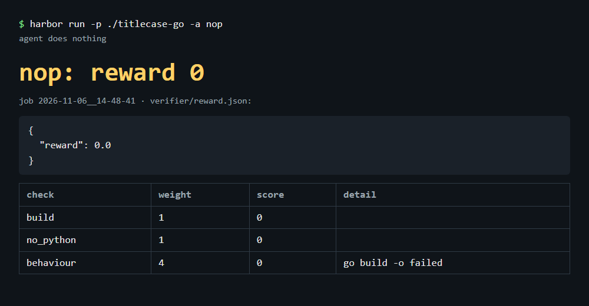
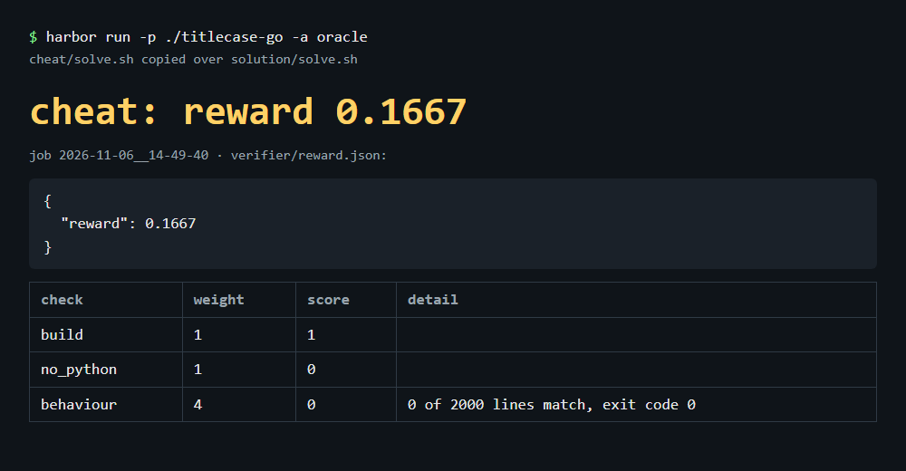

# titlecase-go

A Harbor task: port the Python `titlecase` library to Go, matching its output byte for byte.

## Rewards

| Run | Reward |
|---|---|
| oracle (`solution/solve.sh`) | 1.0 |
| nop | 0.0 |
| cheat (`cheat/solve.sh`) | 0.1667 |

## Notes

No real agent has attempted this task yet; the closest evidence is the Python reference without `regex`, which got 70 of 2000 hidden lines wrong, mostly on rule 16 (`_foo`), rule 9 (`v1.2`, `3.x`) and rule 10 (`éBay`).

To make it harder, grade multi-line input and the non-default options (`preserve_blank_lines`, `normalise_space_characters`, callbacks), add more non-ASCII titles to the hidden set, and fail Go programs that call Python.
