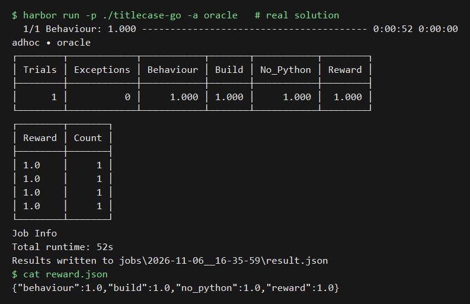
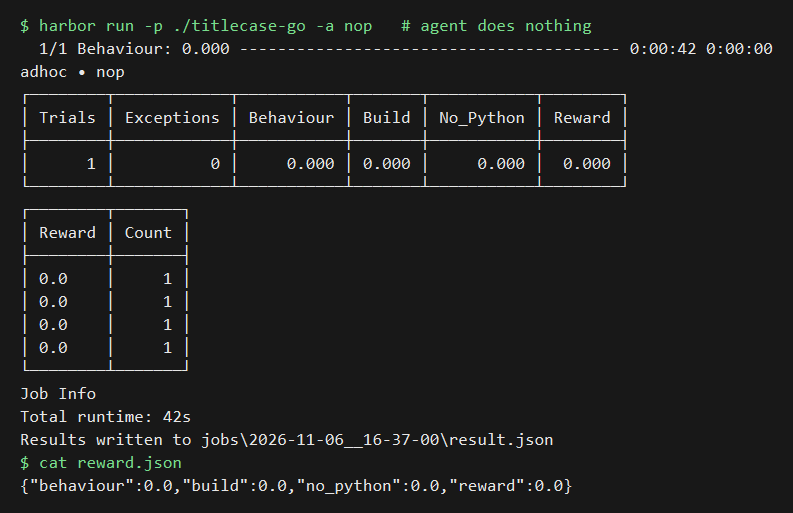
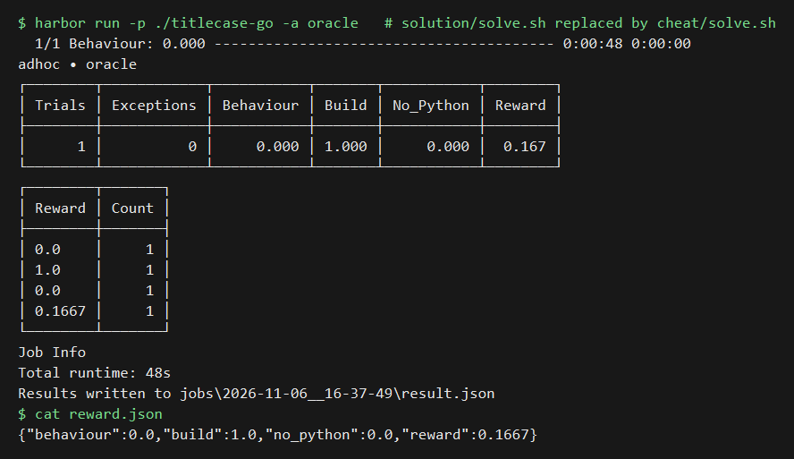

# titlecase-go

A Harbor task: port `titlecase()` from python-titlecase 2.4.1 to a Go program that matches the Python byte for byte.

Source repo: https://github.com/ppannuto/python-titlecase at commit `42f43e2de55bf003b286c6f8e8d8b2d26676a167` (MIT licence).

## Results

| Run | build (weight 1) | no_python (weight 1) | behaviour (weight 4) | Reward |
|---|---|---|---|---|
| oracle | 1.0 | 1.0 | 1.0 | **1.0** |
| nop | 0.0 | 0.0 | 0.0 | **0.0** |
| cheat | 1.0 | 0.0 | 0.0 | **0.1667** |

The images show the captured output of real `harbor run` jobs, drawn to PNG from the text. They are not screen captures.

The cheat run replaced `solution/solve.sh` with `cheat/solve.sh` and ran the oracle agent. The cheat leaves the `.py` files in place. A cheat that also deletes them scores 0.3333, with `behaviour` still 0.0.

## Findings

**Rules got wrong most:** the oracle got none wrong, with 0 mismatches on its first comparison, and no real AI agent has been run yet; switching each rule off shows the most hidden lines depend on small words (56.9%), exact whitespace (26.6%), small first word (22.9%), all-caps lowering (22.2%) and Unicode whitespace (21.6%).

**To make it harder:** add hidden titles for the five behaviours the data never tests (Greek final sigma, `re.I` matching `ı`/`İ` as `i`, `re.I` matching `ſ` as `s`, `_` as both punctuation and a word character, and title-case expansions such as `ß` to `Ss`), plus lines containing `\r`.
