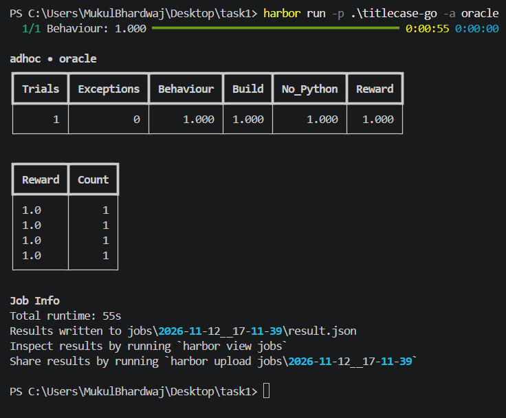
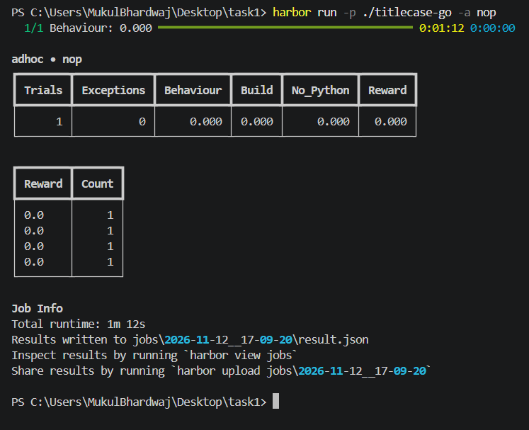
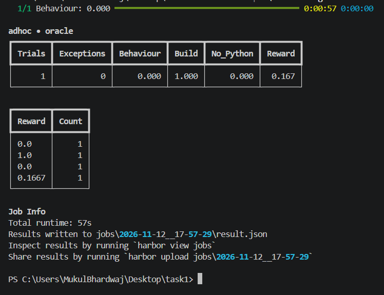

# titlecase-go

`titlecase-go` is a Harbor coding task about porting a Python titlecasing
implementation to Go. The goal is behavioral compatibility—not merely
capitalizing the first letter of each word. The port must preserve the original
handling of small words, phrase boundaries, apostrophes, names, abbreviations,
and hyphenated or slash-separated words.

## The task

Build a Go program in the Harbor workspace that reads one title per line from
standard input and writes one titlecased result per line. For every input, the
output must match the original Python `titlecase()` result byte for byte.

The submitted workspace must:

- Use only the Go standard library.
- Contain no `.py` files.
- Pass `go build ./...`.

The agent workspace is initialized from the upstream Python implementation.
The Harbor verifier runs separately from the agent and executes the submitted
program in an isolated runner, passing input through stdin and checking its
captured output.

## Evaluation

| Category | Weight | What it checks |
|---|---:|---|
| Behaviour | 4 | Output compatibility on private automatic cases; partial credit is available. |
| Build | 1 | `go build ./...` succeeds. |
| No Python | 1 | The submitted workspace has no `.py` files, builds, and passes a public stdin smoke check. |

The overall reward is a weighted mean:

```text
(4 × behaviour + build + no_python) / 6
```

## Run with Harbor

Run this from the task directory with Harbor and Docker available:

```powershell
harbor run -p . -a <agent>
```

Replace `<agent>` with an agent configured in your Harbor environment. Docker
Desktop should be using Linux containers.

Inside the generated Go workspace, the build check is:

```sh
go build ./...
```

## Recorded runs

These screenshots are snapshots of Harbor trial results.

### Perfect run

All three categories scored 1.000.



### No-op baseline

The no-op baseline scored 0.000.



### Partial-credit baseline

This run scored 0.167 overall, with a successful build and zero scores for
behaviour and the No Python check.


