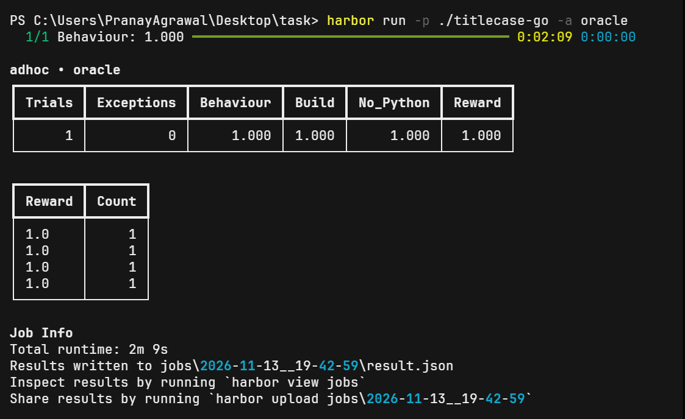
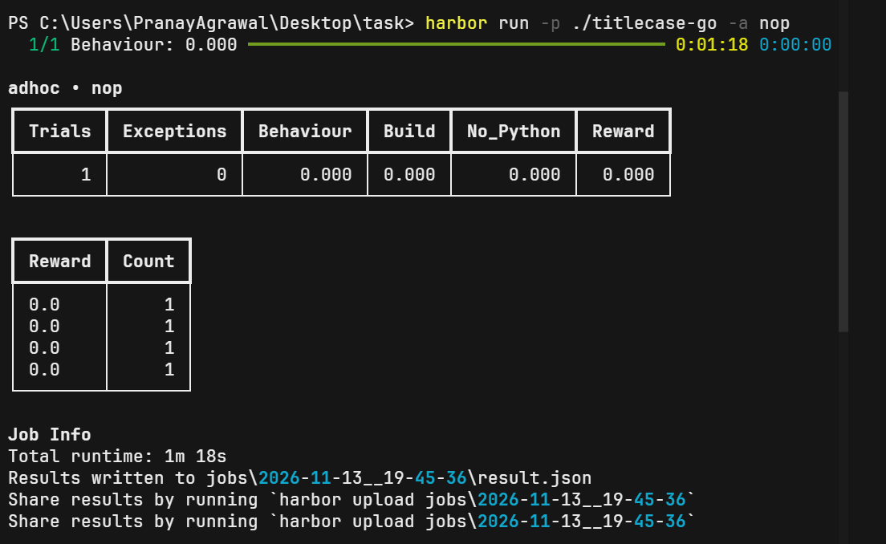
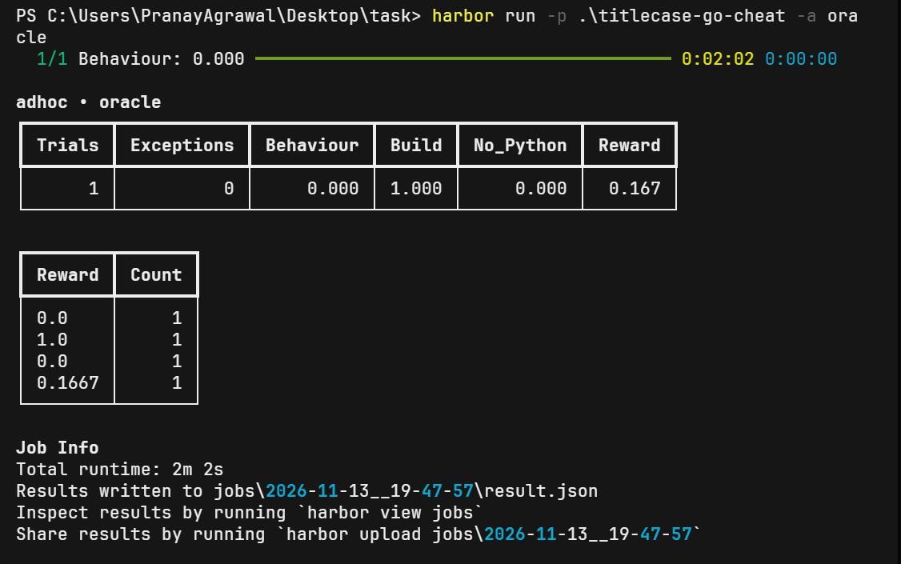

# Titlecase: Python to Go (Harbor Task)

A [Harbor](https://github.com/harbor-framework) benchmark task that ports the Python
[`titlecase`](https://github.com/ppannuto/python-titlecase) library to a Go program
using only the Go standard library.

## Overview

The agent must reimplement Python's `titlecase()` behaviour in Go and replace the
original Python implementation in `/workspace/repo`. The Go program reads one title
per line from standard input and writes the titlecased result to standard output.

The original implementation relies on regular-expression features that Go's
`regexp` package does not support (look-ahead, look-behind, and back-references).
Those rules must be reproduced with hand-written string and rune logic.

## Task Contract

The submitted Go program must:

1. Read titles from stdin, one per line, and write one result per line to stdout.
2. Match the original Python `titlecase()` output **byte for byte**.
3. Use only the Go standard library.
4. Build successfully with `go build ./...`.
5. Remove every Python file from `/workspace/repo`.

## Project Structure

```text
titlecase-go/
├── environment/
│   ├── Dockerfile
│   └── python-titlecase/        # Original Python implementation
├── solution/
│   └── solve.sh                 # Oracle: writes the Go implementation
├── cheat/
│   └── solve.sh                 # Partial-credit probe
├── tests/
│   ├── Dockerfile
│   ├── test.sh
│   ├── reward.toml
│   ├── gen.py
│   ├── build/check.py
│   ├── no_python/check.py
│   ├── behaviour/check.py
│   └── data/
│       ├── inputs.txt
│       ├── expected.txt
│       ├── hidden_inputs.txt
│       └── hidden_expected.txt
├── screenshots/
│   ├── oracle.png
│   ├── nop.png
│   └── cheat.png
├── instruction.md
├── NOTES.md
├── README.md
└── task.toml
```

## Scoring

The verifier uses [Reward Kit](https://github.com/harbor-framework/reward-kit) with
three weighted checks:

| Check | Weight | Description |
|---|---:|---|
| `behaviour` | 4 | Output matches the Python implementation on public and hidden data |
| `build` | 1 | `go build ./...` succeeds |
| `no_python` | 1 | No `.py` files remain in `/workspace/repo` |

Maximum reward: **1.000**.

## Running the Evaluations

Install Harbor:

```bash
uv tool install harbor
```

Run the Oracle (reference solution):

```bash
harbor run -p . -a oracle
```

Run the No-op baseline:

```bash
harbor run -p . -a nop
```

## Evaluation Results

| Evaluation | Behaviour | Build | No_Python | Reward |
|---|---:|---:|---:|---:|
| Oracle | 1.000 | 1.000 | 1.000 | **1.000** |
| No-op | 0.000 | 0.000 | 0.000 | **0.000** |
| Cheat | 0.000 | 1.000 | 0.000 | **0.167** |

### Oracle — reward 1.000



### No-op — reward 0.000



### Cheat — reward 0.167



## Notes

- The Oracle writes `go.mod` and `main.go` into `/workspace/repo`, then deletes all
  Python files and `__pycache__` directories.
- The `cheat/` solution is intentionally incomplete. It builds, so it earns the
  build point, but it does not match the Python behaviour and leaves Python files
  behind, which is why its reward is only `0.167`.
- The Go implementation was verified byte-for-byte against the original Python
  library on both public and hidden fixtures, plus additional differential fuzzing.

## License

The original Python `titlecase` library is distributed under the MIT License. See
`environment/python-titlecase/LICENSE.txt`.
