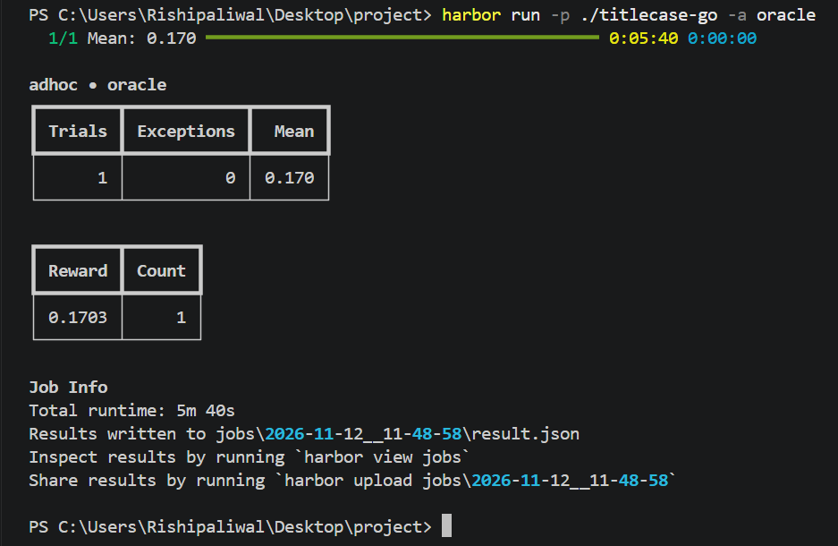
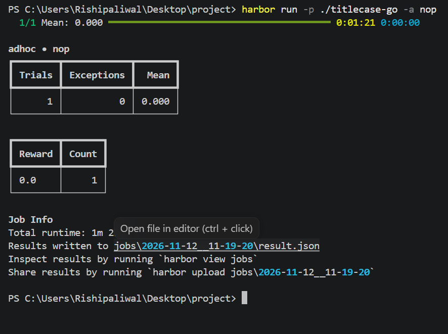
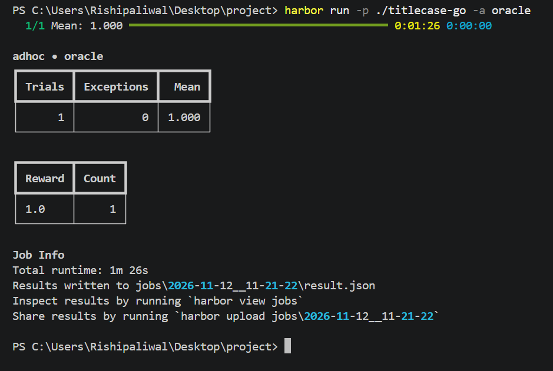

# Harbor Training: Titlecase Go

This project ports the upstream Python `titlecase()` behavior to a Go program and evaluates it with a hidden-input Harbor verifier. The task includes a reference implementation, weighted Reward Kit checks, and a deliberately non-generalizing cheat used to confirm that the hidden behavior check catches hard-coded output.

## Verification screenshots

| Result | Screenshot |
|---|---|
| Cheat verification |  |
| No-Python check |  |
| Oracle verification |  |

## Upstream

- Repository: https://github.com/ppannuto/python-titlecase
- Commit: `42f43e2de55bf003b286c6f8e8d8b2d26676a167`
- License: MIT
