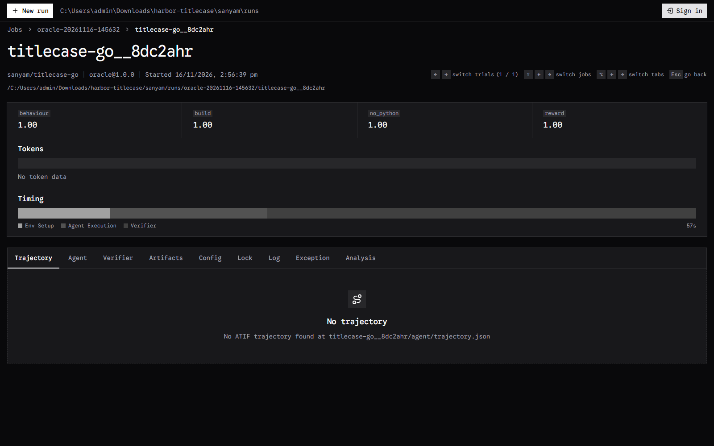
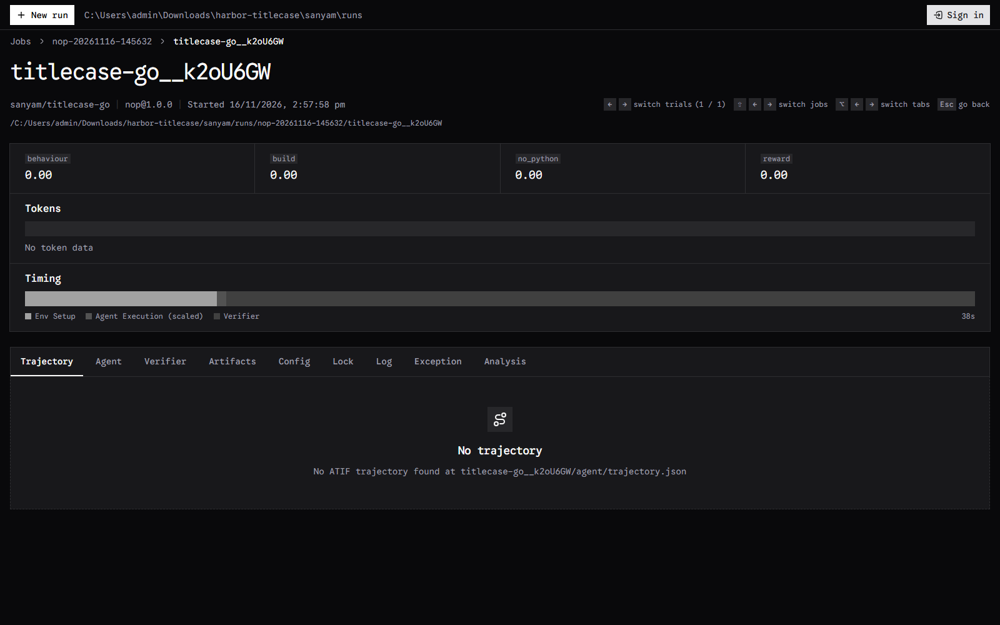
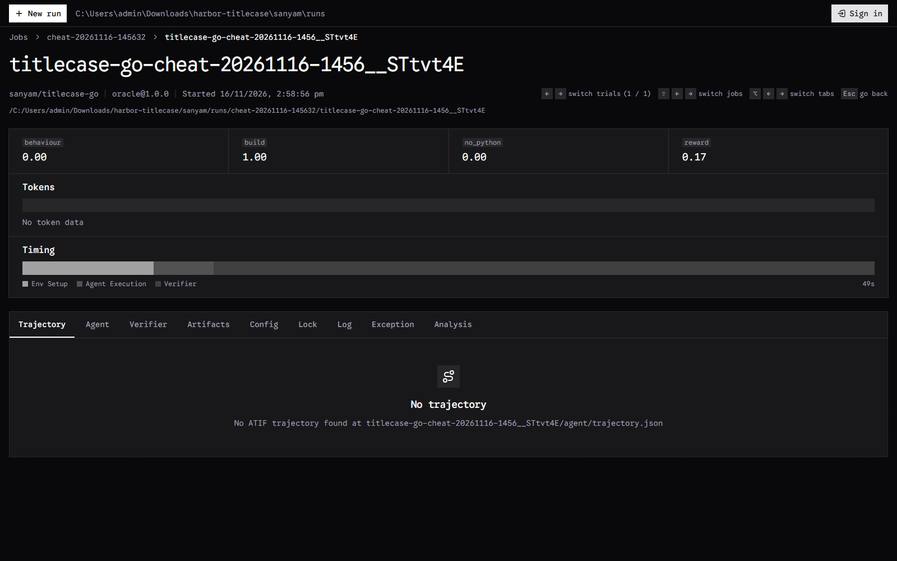

# sanyam/titlecase-go

A [Harbor](https://github.com/laude-institute/harbor) task by Sanyam Sehrawat.

The agent gets [python-titlecase](https://github.com/ppannuto/python-titlecase) 2.4.1 and
must replace it with a Go program that produces byte-identical output for every line, then
delete the Python code. Grading is a weighted mean of a build check, a "no Python left"
check and the share of 2000 hidden titles answered exactly like the original.

- [instruction.md](instruction.md): what the agent is told.
- [NOTES.md](NOTES.md): source, rules with checked examples, traps, design, results.

## Results

| Trial | What runs | Reward | Required |
|---|---|---|---|
| oracle | `solution/solve.sh` (the reference Go port) | **1.0** | 1.0 |
| nop | nothing | **0.0** | 0.0 |
| cheat | `cheat/solve.sh` (prints the visible answers) | **0.1667** | below 0.2 |





## Reproduce

Docker running, `harbor` installed (`uv tool install harbor`), from this folder:

```
python scripts/validate.py
```

It runs the three trials and exits 0 only if all three rewards are as required. One trial
by hand: `harbor run -p . -a oracle`.

Rebuild the answer sheets (must leave `tests/data/` unchanged):

```
pip install regex
python tests/gen.py
```

Compare the Go port with the original on 60,000 random titles, inside the agent image:

```
docker build -t titlecase-go-env environment
docker run --rm -v "$PWD:/task" titlecase-go-env sh -c \
  'cd /task/solution/src && go build -o /tmp/tc . && python3 /task/scripts/fuzz.py /tmp/tc 60000 wide'
```

## Two lines for the hand-in

**Rules that were hardest to get right:** the first-word, last-word and sub-phrase rules for
small words (which alternative the regex tries first and whether it eats the dot, as in
`x. v. a b` → `X. V. a B`), the all-caps test with Python's multi-character `upper()` (`ß`
→ `SS`), and the `Mc` rule re-running the whole line logic on the tail of the word.

**To make it harder:** pay the build and no-Python points only when behaviour clears a
threshold (an empty program plus deleting the Python files currently scores 0.33), and
widen the character set to Greek and Turkish letters, where Python's and Go's case
mappings disagree (final sigma, dotted İ).
