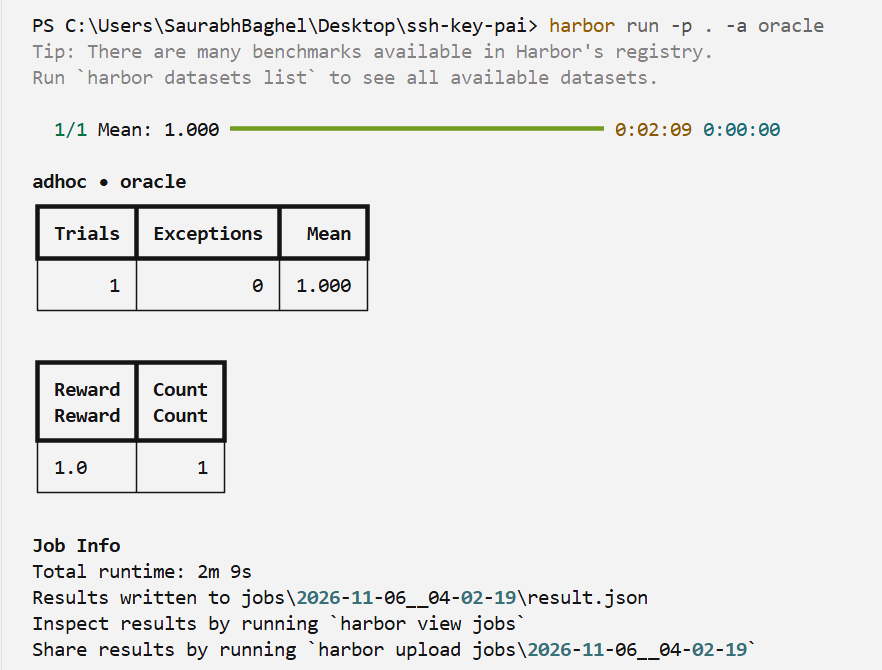
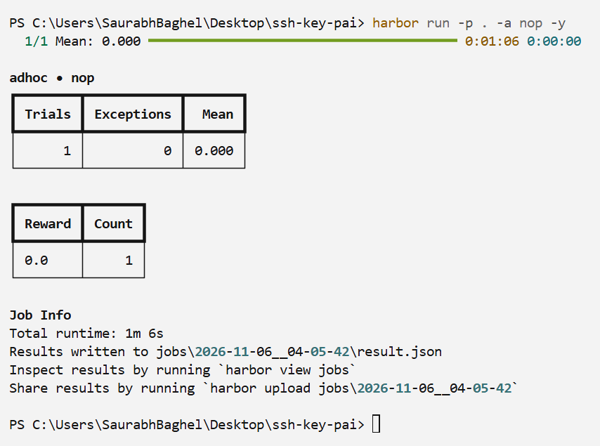

# SaurabhBaghel/titlecase-go

Harbor task that ports python-titlecase 2.4.1 to Go with byte-for-byte `titlecase()` compatibility.

**Author:** Saurabh Baghel

## Validation

Oracle reward is 1.000.

Do-nothing reward is 0.000.

