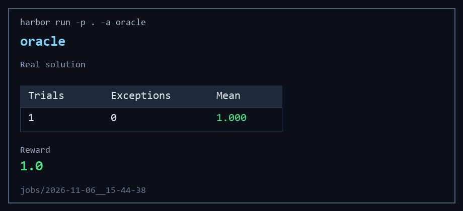
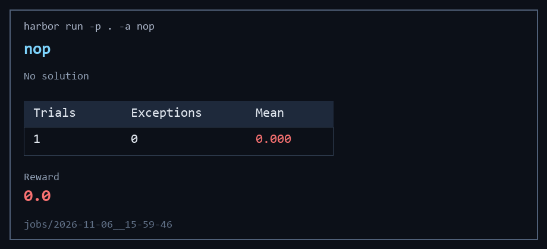
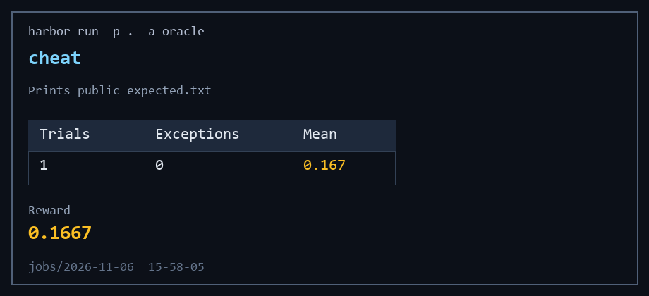

# test/titlecase-go

Oracle **1.0**, nop **0.0**, cheat **0.1667**.

A port misses small-word rules most often: a small word at either end, and a small word after `:` `.` `;` `?` `!` or a dash, including when that match is only a prefix of a longer word.

To make it harder, hide the Python source and also grade `callback`, `preserve_blank_lines`, and `normalise_space_characters`.
