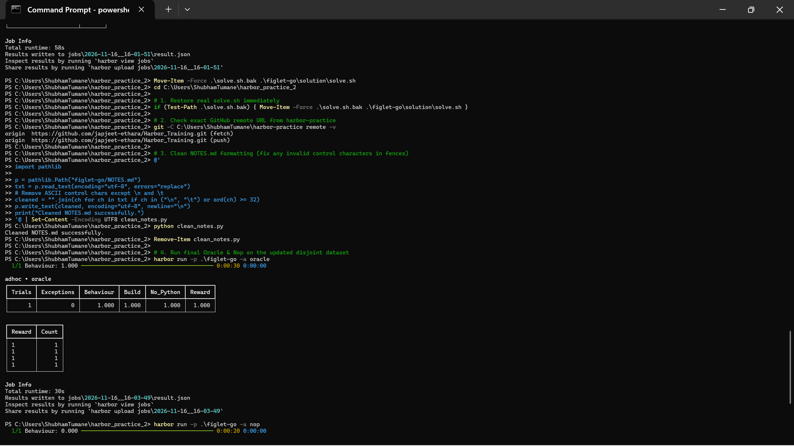
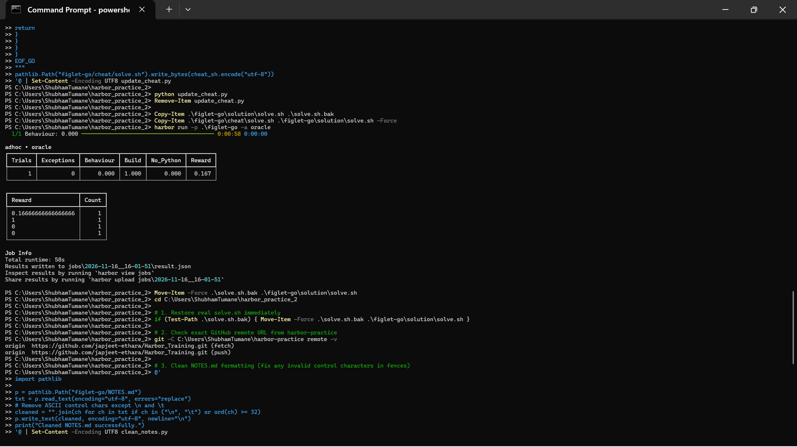
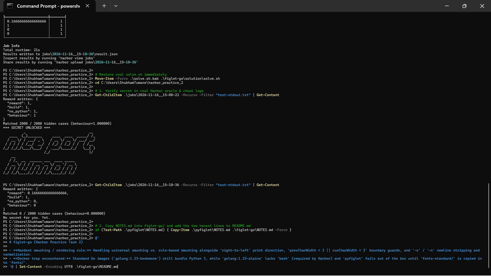
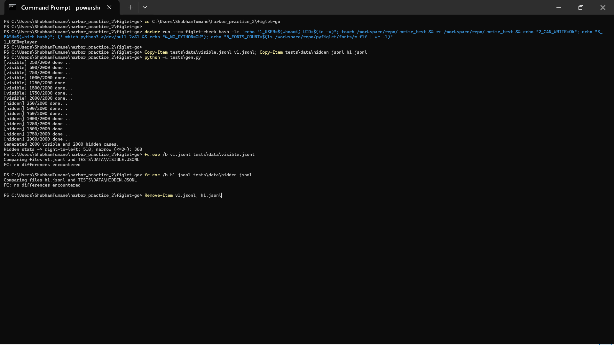
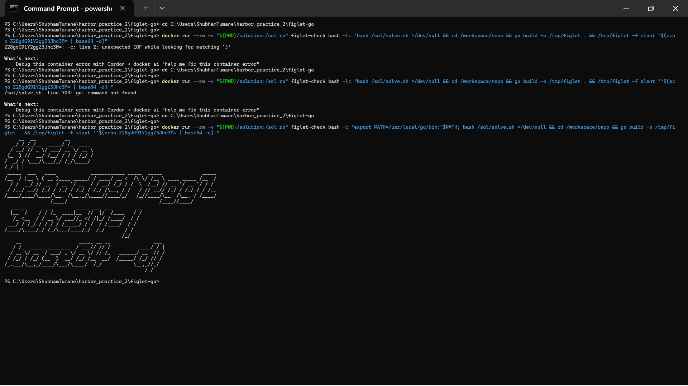
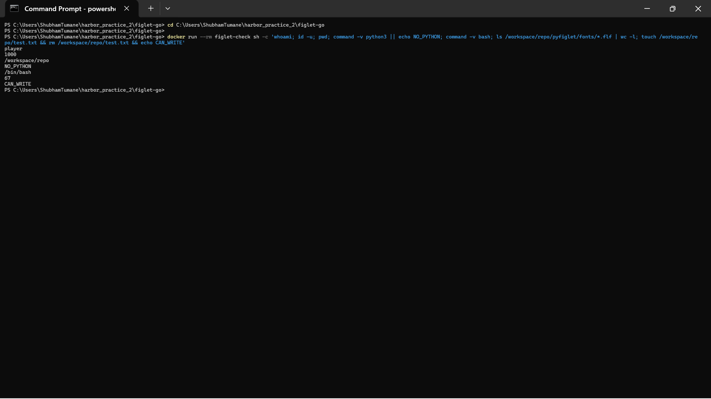

# figlet-go (Harbor Practice Task 2)

- **GitHub Submission Path:** https://github.com/japjeet-ethara/Harbor_Training/tree/main/ShubhamTumane/figlet-go

## Reflection (Two Honest Lines)
- **Hardest smushing / rendering rule:** Handling universal smushing vs. rule-based smushing alongside `right-to-left` print direction, `prevCharWidth < 2 || curCharWidth < 2` boundary guards, and `-s` / `-n` newline stripping and normalization.
- **Docker trap encountered:** Standard Go images (`golang:1.23-bookworm`) still bundle Python 3, while `golang:1.23-alpine` lacks `bash` (required by Harbor) and `pyfiglet` fails out of the box until `fonts-standard/` is copied into `fonts/`.

## Verification Screenshots

### 1. Oracle (`1.000`) & Nop (`0.000`) Rewards

### 2. Cheat Check (`0.167 < 0.2` via `visible.jsonl` lookup)

### 3. Secret Unlocked (`nice port, human`) & Cheat Log

### 4. Docker Self-Checks & Generator Determinism Diff

### 5. Page Secret Verification (`go touch grass`)

### 6. Docker 6-Check Environment Verification

