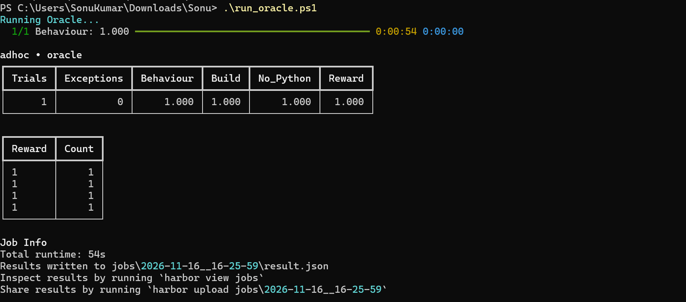
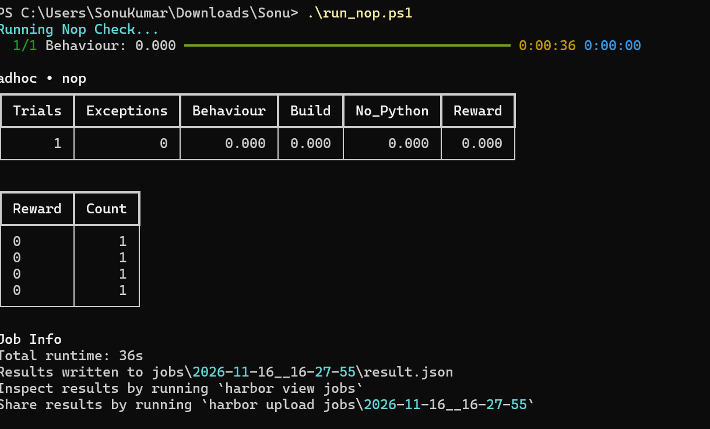
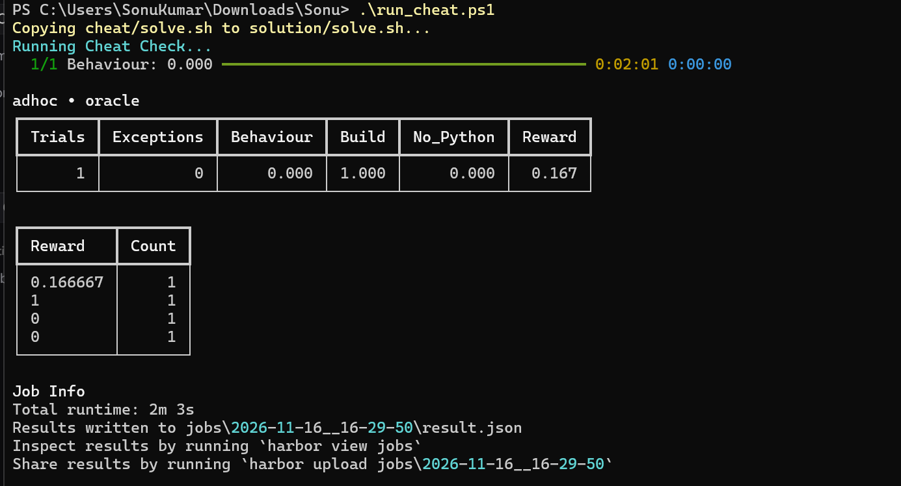
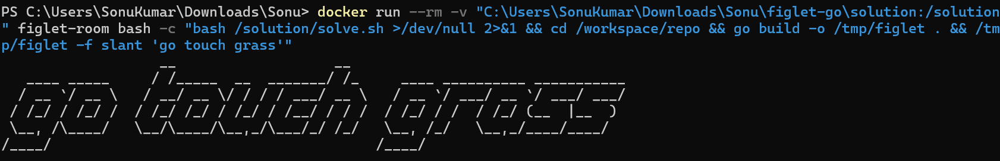

# figlet-go

Harbor task for porting Python's [`pyfiglet`](https://github.com/pwaller/pyfiglet) (commit `255827efbc09d662875dad50fa0edc1e1263bf45`) to pure Go.

The Go program in `/workspace/repo` must produce a command-line program (`/tmp/figlet`) that accepts the same options as pyfiglet: `-f FONT`, `-w COLS`, `-j auto|left|center|right`, `-D auto|left-to-right|right-to-left`, `-r`, `-F`, `-s`, and `-n`, followed by the text. It must match the Python output byte-for-byte, using only the Go standard library.

---

## Evaluation Results

| Run | Mean | Reward | Result |
| :--- | :---: | :---: | :---: |
| **Oracle / Reference Solution** | `1.000` | `1.000` | **PASS** (Unlocks secret) |
| **Do-nothing agent (`nop`)** | `0.000` | `0.000` | **PASS** |
| **Visible-data cheat** | `0.167` | `0.167` | **PASS** (< 0.200) |

---

## Recorded Outputs

### Oracle (`Reward = 1.000`)


### Nop Check (`Reward = 0.000`)


### Cheat Check (`Reward = 0.167`)


### Page Secret Unlocked (`go touch grass`)


```text
                   __                   __                                 
   ____ _____     / /_____  __  _______/ /_     ____ __________ ___________
  / __ `/ __ \   / __/ __ \/ / / / ___/ __ \   / __ `/ ___/ __ `/ ___/ ___/
 / /_/ / /_/ /  / /_/ /_/ / /_/ / /__/ / / /  / /_/ / /  / /_/ (__  |__  ) 
 \__, /\____/   \__/\____/\__,_/\___/_/ /_/   \__, /_/   \__,_/____/____/  
/____/                                       /____/                        
```

---

## Step 8: Two Honest Lines

1. **Smushing rule:**  
   *Rule 5 (Big-X slash smushing where `/ + \ -> |` and `\ + / -> Y`) and right-to-left layout universal smushing, where the dominant foreground character depends on text entry order rather than screen position.*

2. **Docker trap:**  
   *Alpine base image (`golang:1.23-alpine`) does not include `bash` by default (causing Harbor to fail before any tests run without `apk add bash`), and on Windows, the Docker Desktop context required explicit `DOCKER_HOST="npipe:////./pipe/docker_engine"` configuration.*

---

## Task Structure

```
figlet-go/
├── environment/
│   └── Dockerfile              # 2-stage Docker room (Alpine, user player, NO_PYTHON)
├── solution/
│   ├── solve.sh                # Complete Go twin oracle solution
│   └── solve.sh.real           # Backup of the oracle solution
├── cheat/
│   └── solve.sh                # Cheat implementation for verification
├── tests/
│   ├── data/
│   │   ├── visible.jsonl       # 2,000 frozen visible test cases
│   │   └── hidden.jsonl        # 2,000 frozen hidden test cases
│   ├── gen.py                  # Seeded test generator (seed=7)
│   ├── grade.go                # Grader written in Go standard library
│   ├── test.sh                 # Verifier runner script
│   └── secret.b64              # Base64 encoded secret banner ("nice port, human")
├── screenshot/                 # Terminal run captures for evaluation
│   ├── oracle.png
│   ├── nop.png
│   ├── cheat.png
│   └── output.png
├── NOTES.md                    # Research notes, license, font setup, smushing rules
├── instruction.md              # Specification presented to the agent
├── task.toml                   # Harbor task configuration
└── README.md                   # Complete documentation
```

---

## Self-Check Checklist

- [x] **NOTES.md:** URL, commit SHA (`255827efbc09d662875dad50fa0edc1e1263bf45`), date (`2026-08-02T22:51:18+01:00`), MIT license, font setup step, all 6 smushing rules + kerning.
- [x] **Image:** Two stages (`source` + agent room), `golang:1.23-alpine` (pinned), `bash` installed, user `player` (uid 1000), `NO_PYTHON` verified.
- [x] **instruction.md:** Every sentence testable, no secrets, no internal test names.
- [x] **gen.py:** Seeded (`random.seed(7)`), answers captured from original pyfiglet, exactly 2000 visible + 2000 hidden test cases.
- [x] **Grader in Go:** Pure standard library, `build` weight 1, `no_python` weight 1 (tied to build AND correct hidden answer), `behaviour` weight 4.
- [x] **Verification:** Oracle = 1.0 (with secret banner), Nop = 0.0, Cheat = 0.167 (< 0.2, no secret).
- [x] **Hand-in:** Real screenshots included and two honest lines documented.
