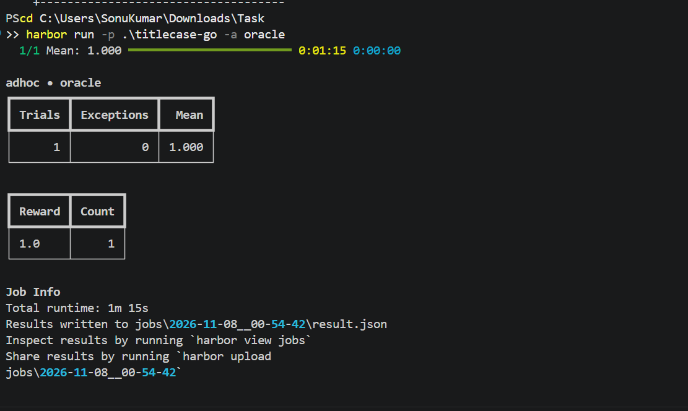
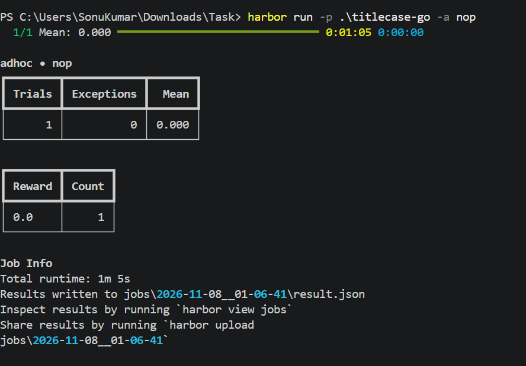
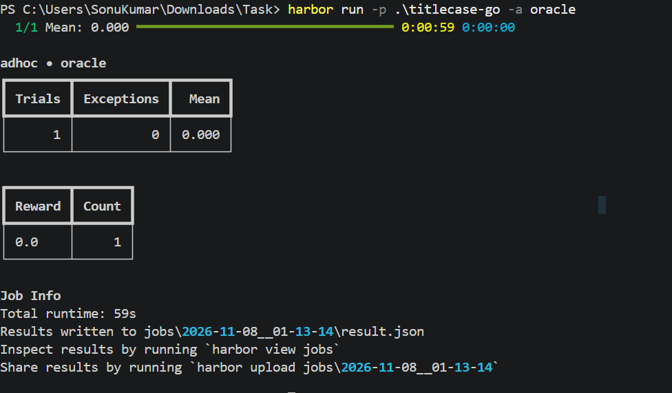

# titlecase-go

Harbor task for porting the Python
[`titlecase`](https://github.com/ppannuto/python-titlecase) behavior to Go.

The program reads one title per line from `stdin` and writes one title-cased
line to `stdout`. It must preserve whitespace and match the Python output
byte-for-byte, using only the Go standard library.

## Usage

```console
$ go build ./...
$ printf "the lord of the rings\nstate-of-the-art design\n" | ./titlecase-go
The Lord of the Rings
State-of-the-Art Design
```

The full behavior contract is documented in
[`instruction.md`](instruction.md).

## Evaluation

The verifier checks:

1. `go build ./...` succeeds.
2. No `.py` files remain in the workspace.
3. Output matches the hidden expected answers.

Run the Harbor evaluations with:

```console
$ harbor run -p .\titlecase-go -a oracle
$ harbor run -p .\titlecase-go -a nop
```

## Recorded outputs

| Run | Mean | Reward |
| --- | ---: | ---: |
| Oracle/reference solution | `1.000` | `1.0` |
| Do-nothing agent (`nop`) | `0.000` | `0.0` |
| Visible-data cheat | `0.000` | `0.0` |

### Oracle



### Nop



### Cheat



## Repository contents

- [`instruction.md`](instruction.md): agent task instructions
- [`solution/solve.sh`](solution/solve.sh): reference solution
- [`tests/`](tests/): verifier and test data
- [`environment/`](environment/): Docker environment and source project
- [`screenshots/`](screenshots/): recorded Harbor outputs

The original Python project is MIT licensed.
