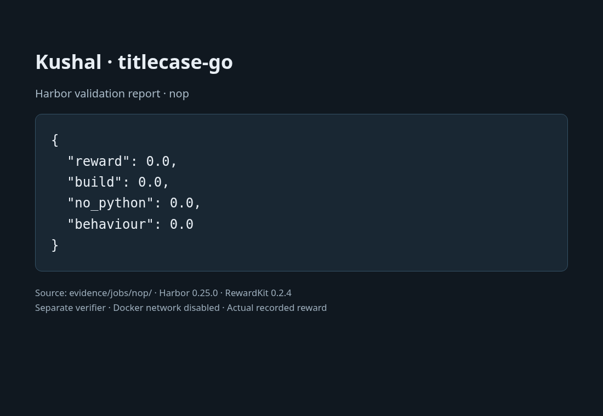
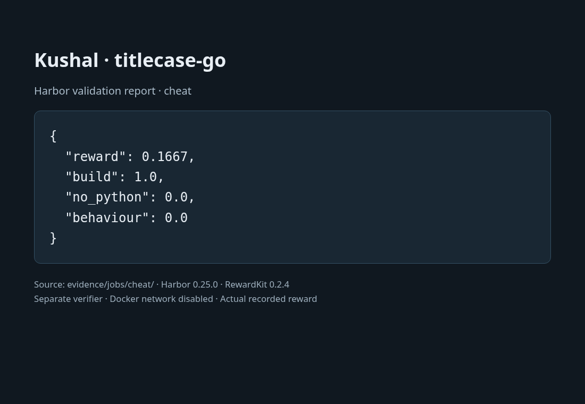

# Kushal — titlecase-go

A section 18 Harbor submission built around a rune-based pipeline with explicit boundary matching.
The corpus uses a balanced matrix of individual rules. The program uses only the Go standard library.

## Verified results

| Run | Reward | Build | No Python | Behavior |
|---|---:|---:|---:|---:|
| Oracle | 1.0 | 1.0 | 1.0 | 1.0 |
| Nop | 0.0 | 0.0 | 0.0 | 0.0 |
| Visible-answer replay | 0.1667 | 1.0 | 0.0 | 0.0 |

The implementation also matched 100,000 independent stress records exactly.
There are 22 passing developer tests covering the line protocol and scorer.
Each frozen split contains 2,000 records; visible and hidden inputs and outputs
are disjoint. Regeneration was checked twice and all answers were checked
against the original Python implementation.

Raw Harbor jobs and rewards are under `evidence/jobs`. The screenshots show
the validation report, backed by those JSON files. The managed-cloud runtime
profile is documented in `evidence/validation-profile.json`; do not confuse
those runs with an unmodified default-image execution.

## Run

Use Docker and a CPython 3.12.14 virtual environment:

```sh
python -m pip install -r requirements-dev.txt
python tools/verify_data.py
python tools/validate.py .
harbor lint . --select ALL
```

`tools/validate.py` runs the real oracle, nop, and replay baseline. It uses
`tools/offline-runtime.json`, which enforces Docker network isolation directly.
New runs are saved separately under `evidence/reruns/`, preserving the bundled evidence.
The replay is installed into a temporary task copy; the actual solution is
never overwritten. Image builds need network access to fetch pinned packages;
agent execution and grading do not.

On a host with Harbor's egress controls available, the ordinary commands are:

```sh
harbor run -p . -a oracle
harbor run -p . -a nop
```

## Additional checks

```sh
python tools/stress.py --reference environment/reference --output work/stress /absolute/path/to/titlefilter
TITLECASE_BINARY=/absolute/path/to/titlefilter python -m pytest -q tools/test_contract.py tools/test_scoring.py
```

The stress tool regenerates its inputs and expected outputs from the original
source. It does not use the Go implementation as its own answer key.

## What makes this submission distinct

- A rune-based pipeline with explicit boundary matching.
- A balanced matrix of individual rules, with manifest hashes and exact-byte comparisons.
- Complete runtime-derived casing tables, including multi-character mappings
  and contextual Greek sigma handling.
- A separate verifier; compilation as an unprivileged user; execution in an
  empty filesystem jail; bounded output and process-group cleanup.
- Actual baseline evidence, a reproducibility check, and explicit limitations.

The fixed 1:1:4 weights permit a buildable empty program with Python removed
to earn 1/3. That limitation is retained to follow the assignment.
See `NOTES.md` for checked rule examples and development observations.

## Hand-in

Create a GitHub repository and upload this folder, including `evidence`.
Include the three reward screenshots. No GitHub identity or repository URL
has been assumed for the author.

The main implementation work was reproducing Python casing, boundaries,
match order, and recursive compounds. To make the task harder, add a separate
multiline/callback task or an independently sampled Unicode holdout, while
keeping every new requirement explicit. A fresh model attempt is optional
and has not been claimed here.

Upstream attribution is preserved in `LICENSE`, `NOTICE.md`, and the snapshot.

## Reward screenshots

These are browser screenshots of the report generated from the raw Harbor rewards.






See [COMPARISON.md](COMPARISON.md) for the broad audit and its limitations. Both new ports tie the best observed functional result.

See [SUBMISSION_TYPES.md](SUBMISSION_TYPES.md) for the implementation categories and the four specifically requested candidates.
