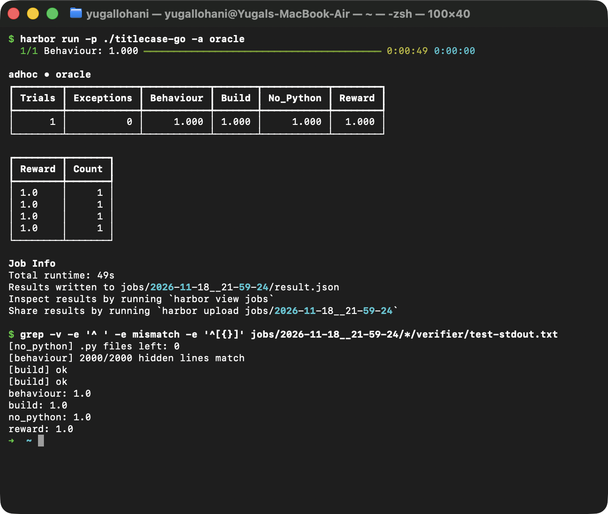
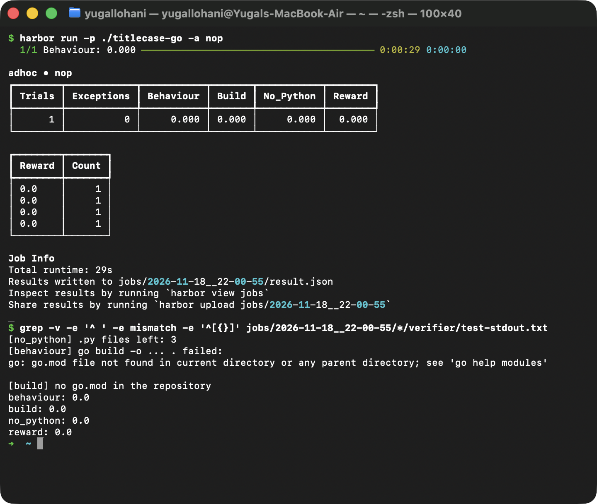
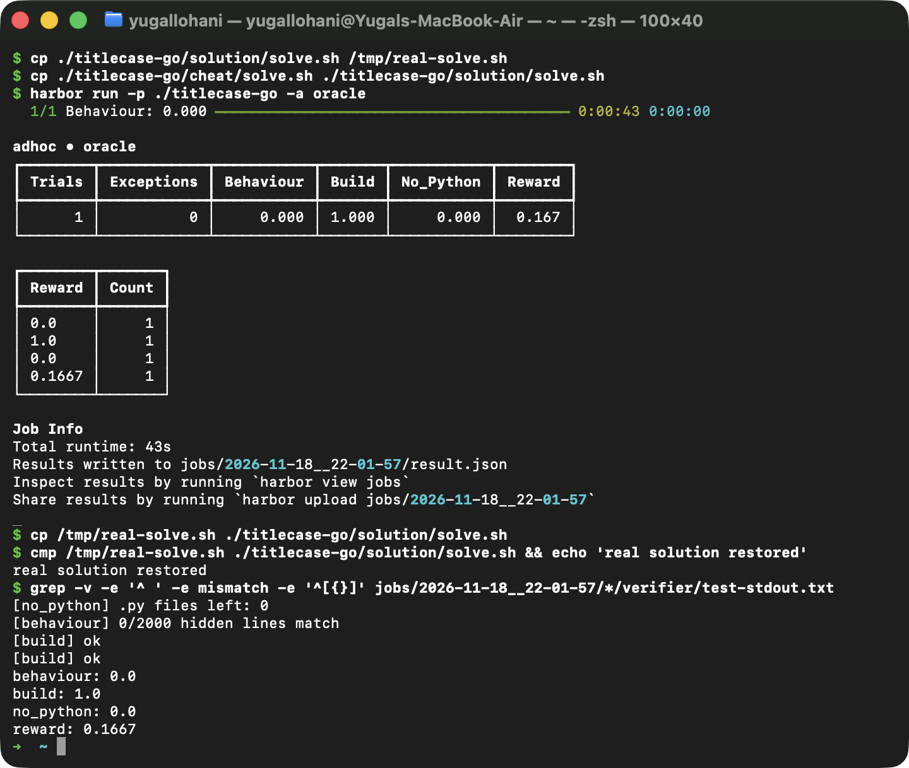

# Results

Harbor 0.26.0, Docker 28.3.0 (Docker Desktop, macOS arm64), run on 2026-11-18 from the
folder that contains `titlecase-go/`. Verifier: separate container (`tests/Dockerfile`),
Reward Kit 0.2.4, weighted mean of build (1), no_python (1), behaviour (4).

| Run | Command | build | no_python | behaviour | reward |
|---|---|---|---|---|---|
| oracle | `harbor run -p ./titlecase-go -a oracle` | 1 | 1 | 1.000 (2000/2000) | **1.000** |
| nop | `harbor run -p ./titlecase-go -a nop` | 0 | 0 | 0.000 | **0.000** |
| cheat | `cheat/solve.sh` copied over `solution/solve.sh`, then `-a oracle` | 1 | 0 | 0.000 (0/2000) | **0.167** |

Expected by hand: nothing done = 0; build only = (1×1 + 0×1 + 0×4) / 6 = 0.167;
perfect = 1.0. All three match. Verifier logs and reward files are in `results/`.

## Screenshots

Real captures of a macOS Terminal window (`screencapture -l <window id>`) taken while
the commands ran (jobs `21-59-24`, `22-00-55`, `22-01-57`):

| Run | File |
|---|---|
| oracle | [`screenshots/oracle.png`](screenshots/oracle.png) |
| nop | [`screenshots/nop.png`](screenshots/nop.png) |
| cheat | [`screenshots/cheat.png`](screenshots/cheat.png) |





## Verifier output (text)

```
oracle:  [no_python] .py files left: 0
         [behaviour] 2000/2000 hidden lines match
         [build] ok
         behaviour: 1.0   build: 1.0   no_python: 1.0   reward: 1.0

nop:     [no_python] .py files left: 3
         [build] no go.mod in the repository
         behaviour: 0.0   build: 0.0   no_python: 0.0   reward: 0.0

cheat:   [no_python] .py files left: 0
         [behaviour] 0/2000 hidden lines match
         [build] ok
         behaviour: 0.0   build: 1.0   no_python: 0.0   reward: 0.1667
```

## Other checks

- **Images:** the agent room is `golang:1.23` pinned by digest, with the repository at
  `/workspace/repo` and no `.git`. The verifier image is built from `tests/`, so the agent
  never sees the tests or the answers.
- **`tests/gen.py`:** run twice under CPython 3.12 + `regex` 2024.11.6, and `diff -r` of the
  two outputs is empty. Each of the 4 files has 2000 lines. The script refuses any other
  interpreter.
- **Cheat:** run by hand in the room, it reproduces `expected.txt` exactly, so its 0.167
  shows that the grader works, not that the cheat is broken.
- **Echo loophole** (a program that prints its input unchanged, after deleting the `.py`
  files): 36/2000 hidden lines, reward **0.179**. `no_python` pays 0 because no line it
  had to change is right.
- **Mutation tests** (`dev/titlecase/mutate.sh`): each Unicode or rule mistake below costs
  hidden lines. All 13 mutants lose points:

  | Mutant | Hidden lines wrong |
  |---|---|
  | no all-caps line handling | 339 |
  | `CAPFIRST` title-cases instead of `upper()` (`dž` -> `Dž`) | 134 |
  | `Mac` treated like `Mc` | 99 |
  | 1:1 upper case (no `ß` -> `SS`, `fi` -> `FI`) | 96 |
  | ASCII-only whitespace split | 58 |
  | right quotes `’ ”` counted as punctuation | 42 |
  | no Greek final sigma | 27 |
  | first-word rule ignores leading space | 25 |
  | no Unicode case folding (`ſ`, `K`, `İ`) | 13 |
  | `SUBPHRASE` case-insensitive | 8 |
  | ASCII-only `\b` | 4 |
  | `SMALL_LAST` without trailing punctuation | 3 |
  | `capitalize()` with upper instead of title | 0 (equivalent, see NOTES rare case 4; kept as a finding) |

- **Extra fuzzing** outside the task (3 seeds × 20,000 random lines over a wide Unicode
  alphabet, compared with the original): 0 differ.
- `harbor lint ./titlecase-go`: no findings.

## Two lines

- **Rules that went wrong:** the PDF's warning about look-arounds does not apply, because
  this commit has none. The hard parts are Python/`regex` Unicode semantics that Go
  lacks: all-caps line detection, full case mapping (`ß` -> `SS`), Greek final sigma,
  Unicode `\s`/`\b`, and case folding (`İn` is a small word). My own port matched on the
  first full comparison. The only failure was the oracle's first Harbor run (0.667):
  `go build ./...` could not write its `titlecase` binary over the emptied `titlecase/`
  package folder.
- **To make it harder:** remove Python from the room and run the agent as a non-root user
  (as in Task 2), and test the word-list callback and `preserve_blank_lines` options.
  Multi-line input with `\r\n` would also exercise the `[\r\n]+` line split.
